# 编辑器系统架构文档

---

## 1. 概述

Elaine Editor 是 Elaine Engine 的可视化编辑器，基于 **ImGui (DX11 后端)** 构建。编辑器作为独立可执行程序，依赖 ElaineCore、ElaineEngine 和 ElaineReflection 模块，提供场景编辑、属性检查、内容浏览等功能。

---

## 2. 架构总览

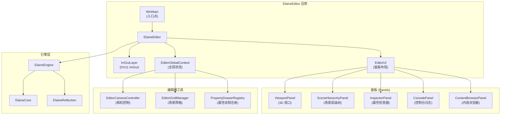

---

## 3. 核心类

### 3.1 ElaineEditor

```cpp
class ElaineEditor {
    bool Initialize(PlatformWindow* window);  // 初始化 ImGui + DX11
    void Destroy();                            // 清理资源
    void Run();                                // 主循环
    void Tick();                               // 单帧：ImGui BeginFrame → Draw → EndFrame
};
```

**生命周期：**

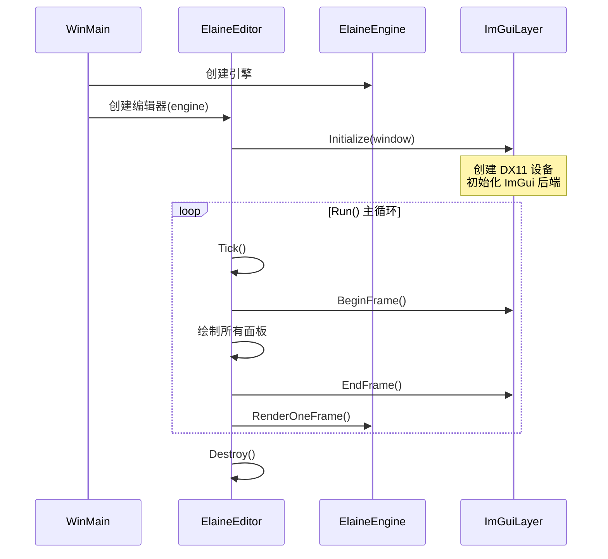

### 3.2 ImGuiLayer

ImGui 渲染层，管理 DX11 设备和 ImGui 上下文：

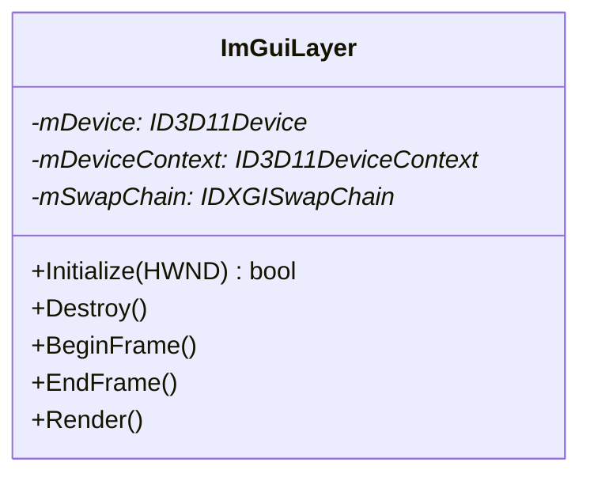

> **双渲染架构说明：** 引擎场景使用 Vulkan 离屏渲染到 `OffscreenRenderTarget`，编辑器 UI 使用 DX11 + ImGui 渲染到窗口。引擎渲染结果通过共享纹理传递给 ImGui 的 ViewportPanel 显示。

### 3.3 EditorGlobalContext

编辑器全局上下文，管理编辑器级别的全局状态：

```cpp
class EditorGlobalContext {
    // 编辑器相机控制
    // 选中对象管理
    // 编辑器模式状态
    // Gizmo 状态
    // ...
};
```

### 3.4 EditorUI

编辑器 UI 管理器，负责面板的布局和绘制调度。

---

## 4. 面板系统

### 4.1 ViewportPanel (3D 视口)

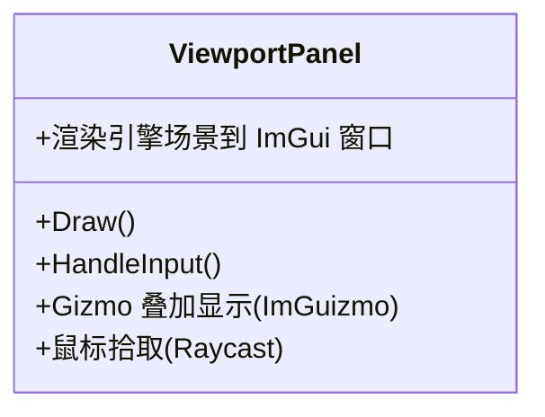

**关键特性：**
- 显示 Vulkan 离屏渲染结果
- ImGuizmo 集成：平移/旋转/缩放 Gizmo
- 鼠标拾取：通过 SceneManager::Raycast 实现
- 编辑器相机控制（WASD + 鼠标右键旋转）

### 4.2 SceneHierarchyPanel (场景层级)

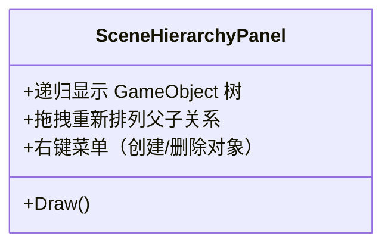

**功能：**
- 树形显示 World 中所有 GameObject
- 支持选择、多选
- 右键上下文菜单
- 拖拽调整层级关系

### 4.3 InspectorPanel (属性检查器)

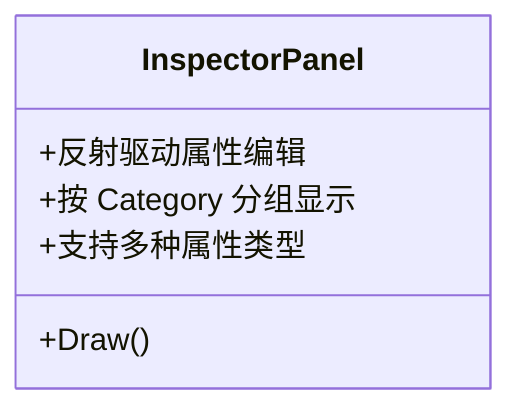

**工作原理：**

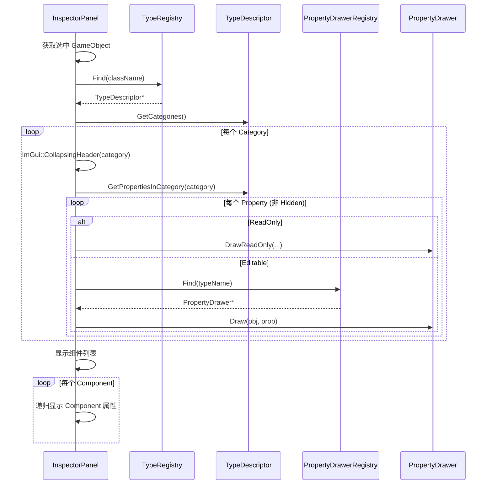

### 4.4 ContentBrowserPanel (内容浏览器)

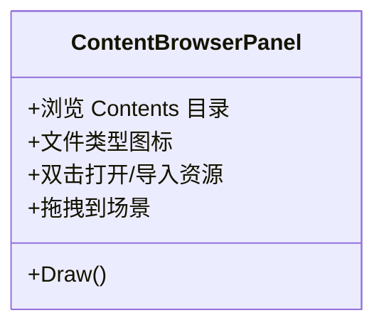

**功能：**
- 文件系统导航（Contents 目录）
- 按文件类型显示图标
- 支持文件搜索
- 拖拽资源到场景（如模型、材质）

### 4.5 ConsolePanel (控制台)

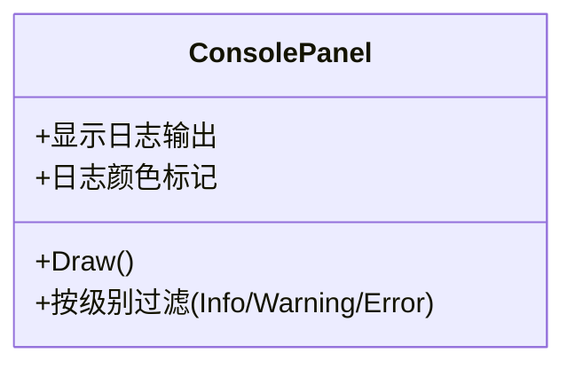

---

## 5. PropertyDrawer 系统

### 5.1 架构

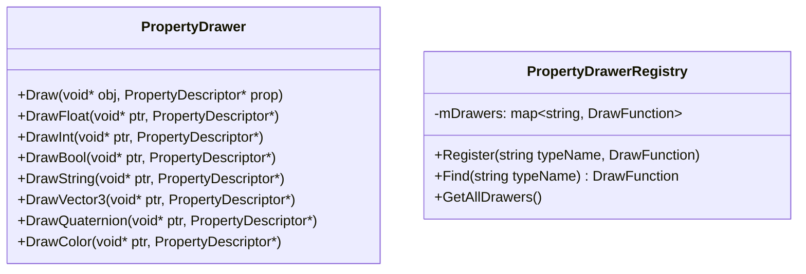

### 5.2 属性类型 → 控件映射

| 属性类型 | ImGui 控件 |
|----------|-----------|
| `float` | `ImGui::DragFloat` |
| `int` | `ImGui::DragInt` |
| `bool` | `ImGui::Checkbox` |
| `std::string` | `ImGui::InputText` |
| `Vector3` | 3 个 `ImGui::DragFloat` |
| `Quaternion` | 欧拉角 `ImGui::DragFloat3` |
| `Color` | `ImGui::ColorEdit4` |

### 5.3 反射元数据驱动

PropertyDrawer 读取反射元数据自定义行为：

```cpp
// DisplayName → 标签文本
ImGui::Text(prop->GetDisplayName());

// Tooltip → 悬停提示
if (ImGui::IsItemHovered())
    ImGui::SetTooltip(prop->GetTooltip());

// ReadOnly → 禁用编辑
if (prop->IsReadOnly())
    ImGui::BeginDisabled();

// Category → 分组折叠
ImGui::CollapsingHeader(prop->GetCategory());

// Hidden → 跳过绘制
if (prop->IsHidden()) continue;
```

---

## 6. 编辑器相机控制器

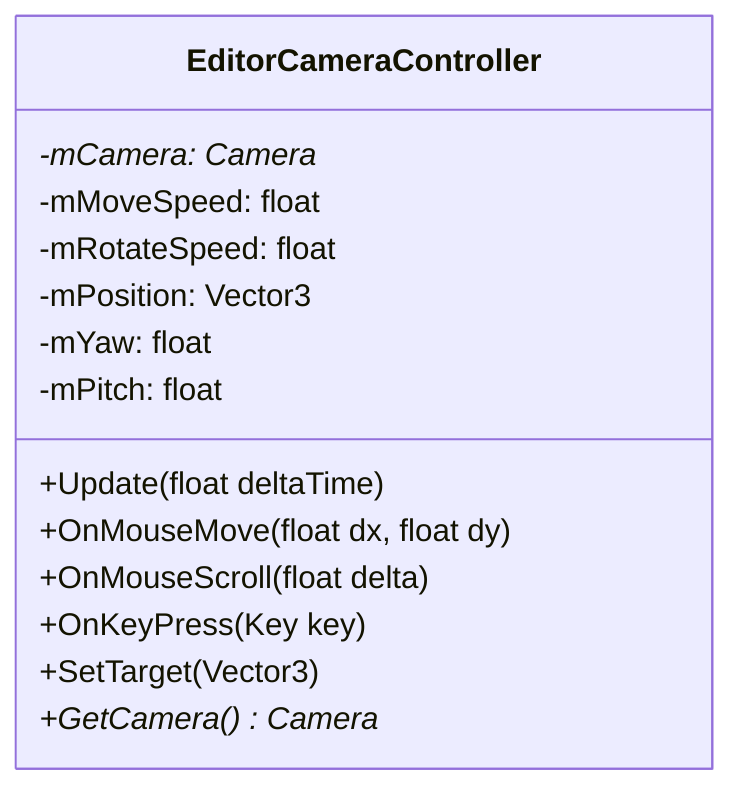

**控制方式：**

| 操作 | 功能 |
|------|------|
| 鼠标右键 + 移动 | 旋转视角 |
| W/A/S/D | 前/左/后/右 移动 |
| Q/E | 下降/上升 |
| 鼠标滚轮 | 缩放（移动速度调整） |
| F | 聚焦选中对象 |

---

## 7. 编辑器网格管理器

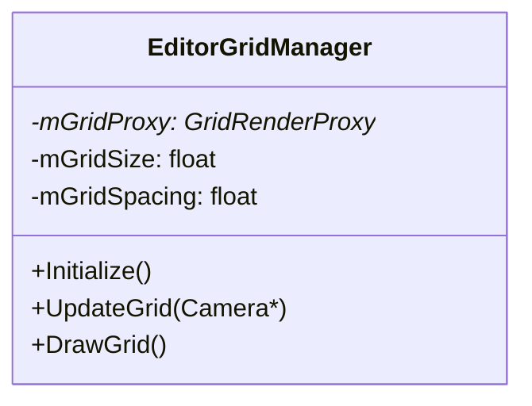

在编辑器模式下渲染参考网格，帮助定位和对齐。

---

## 8. 编辑器构建配置

编辑器仅在以下配置下编译和运行：

| 配置 | 宏定义 | 说明 |
|------|--------|------|
| EditorDebug | `_HAS_EDITOR_`, `_DEBUG` | 编辑器调试模式 |
| EditorRelease | `_HAS_EDITOR_`, `_NODEBUG` | 编辑器发布模式 |

`_HAS_EDITOR_` 宏控制编辑器特定代码的编译：

```cpp
#ifdef _HAS_EDITOR_
    std::vector<Component*>& GetEditorComponents() { return m_components; }
#endif
```

---

## 9. 第三方库依赖

| 库 | 版本 | 用途 |
|----|------|------|
| ImGui | - | 即时模式 UI 框架 |
| ImGuizmo | - | 3D Gizmo (平移/旋转/缩放) |
| DX11 | - | ImGui 渲染后端 |
| GLFW | - | 窗口管理与输入 |

---

## 10. 编辑器目录结构

```
ElaineEditor/
├── CMakeLists.txt
├── Generated/                    # 反射生成的编辑器代码
│   └── *.editor.generated.cpp
├── Public/                       # 头文件
│   ├── ElaineEditor.h           # 编辑器主类
│   ├── ElaineEditorBase.h       # 编辑器基础定义
│   ├── ElaineEditorGlobalContext.h  # 全局上下文
│   ├── ElaineEditorCameraController.h
│   ├── ElaineEditorGridManager.h
│   ├── ElaineEditorUI.h
│   ├── ElaineImGuiLayer.h
│   ├── ElaineViewportPanel.h
│   ├── ElaineSceneHierarchyPanel.h
│   ├── ElaineInspectorPanel.h
│   ├── ElaineConsolePanel.h
│   ├── ElaineContentBrowserPanel.h
│   ├── ElainePropertyDrawer.h
│   ├── ElainePropertyDrawerRegistry.h
│   └── imgui/                   # ImGui 源码与后端
└── Private/                     # 实现文件
    ├── WinMain.cpp              # Windows 入口点
    ├── ElaineEditor.cpp
    ├── ElaineEditorGlobalContext.cpp
    ├── ElaineImGuiLayer.cpp
    ├── ElaineViewportPanel.cpp
    ├── ElaineInspectorPanel.cpp
    ├── ElainePropertyDrawer.cpp
    └── ...
```
