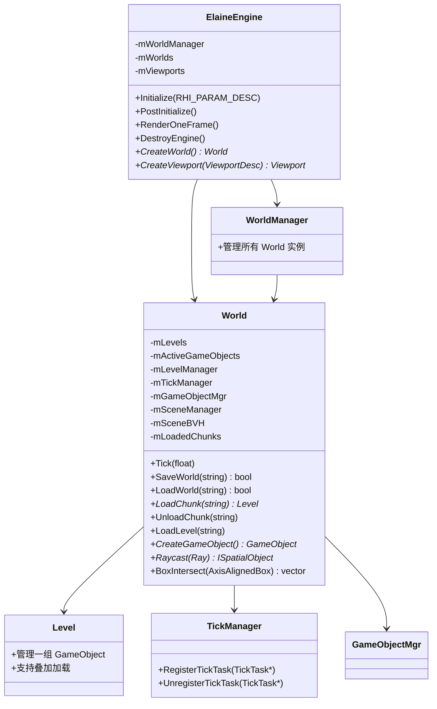
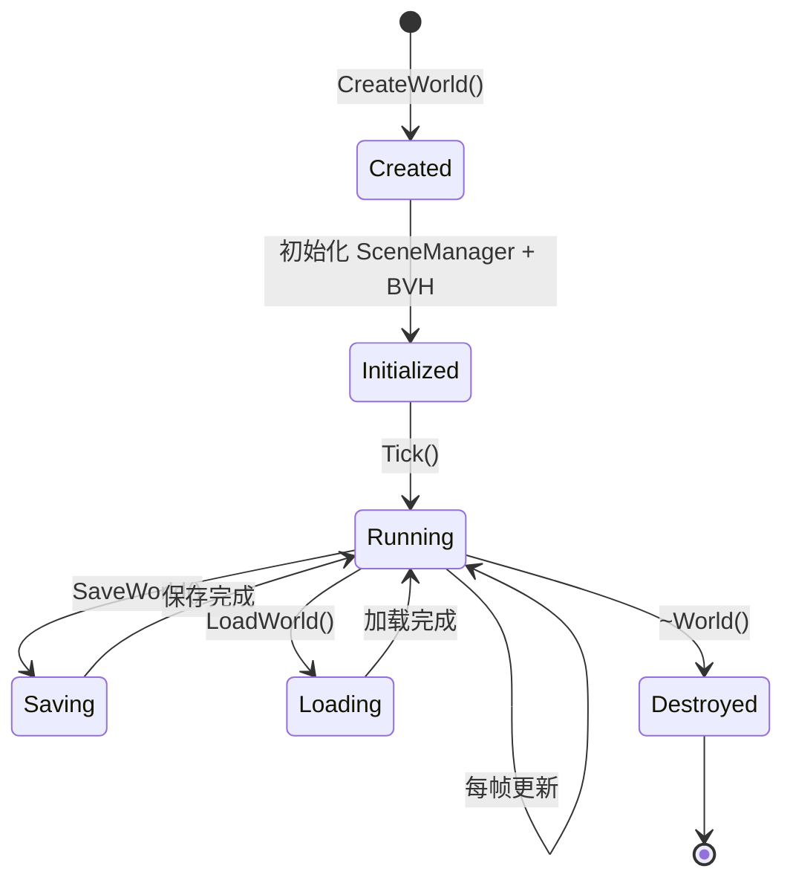
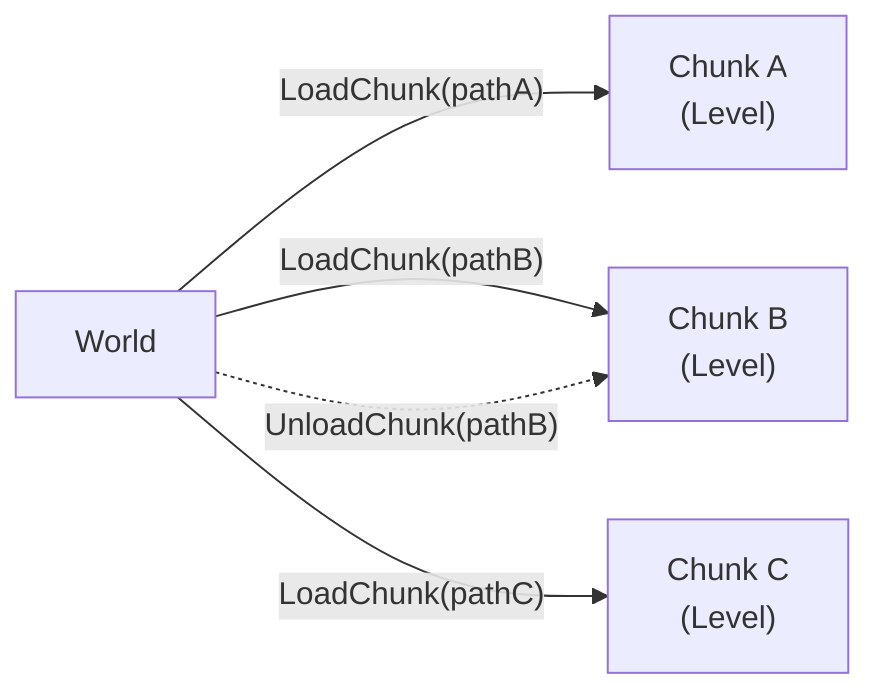
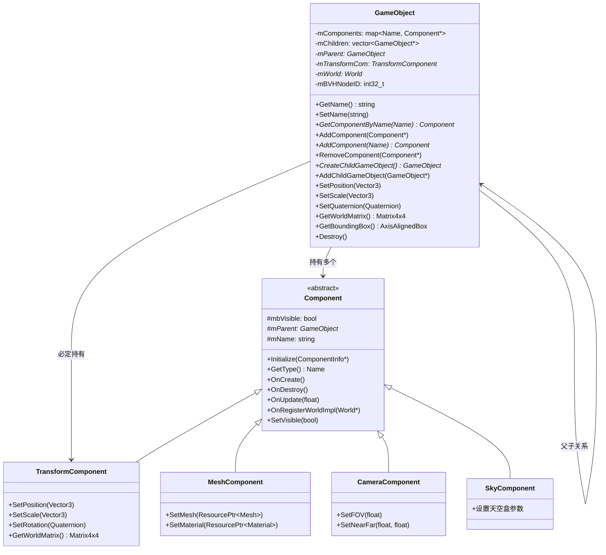
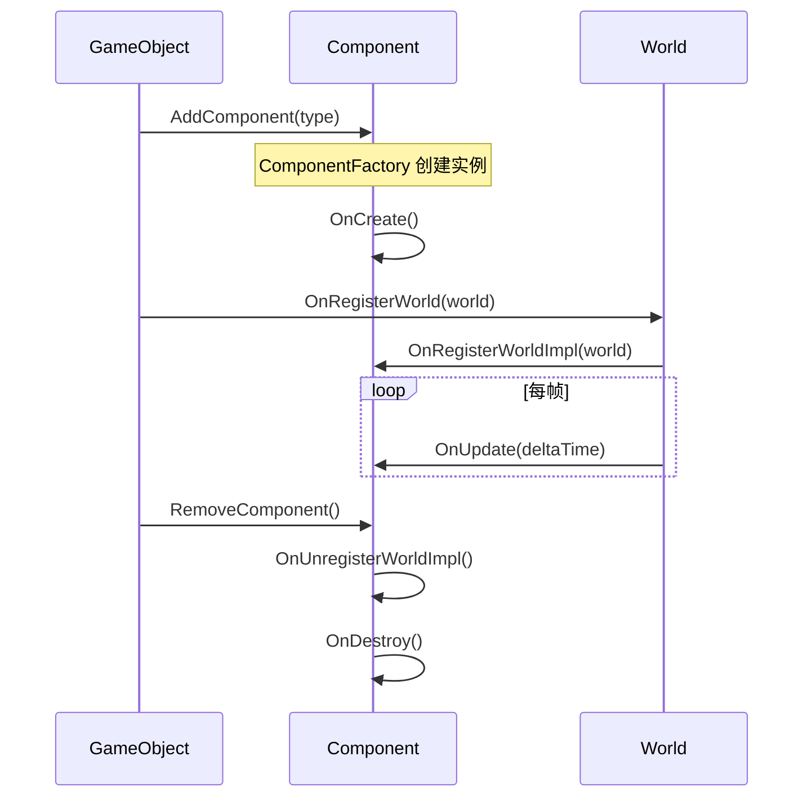
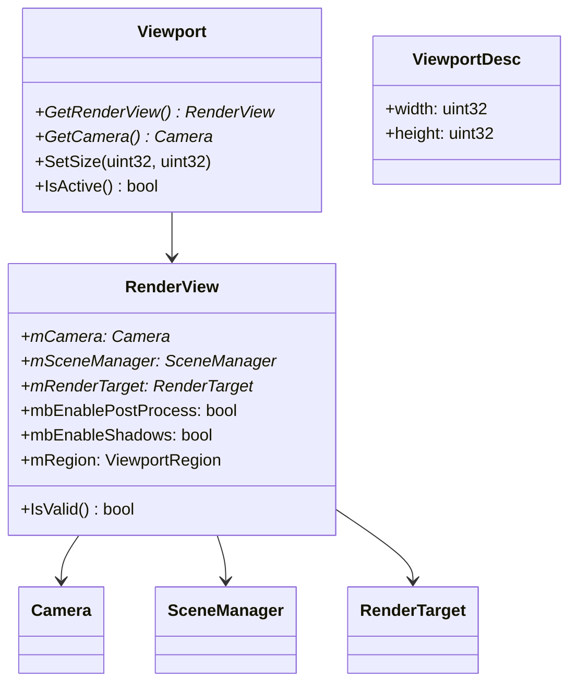
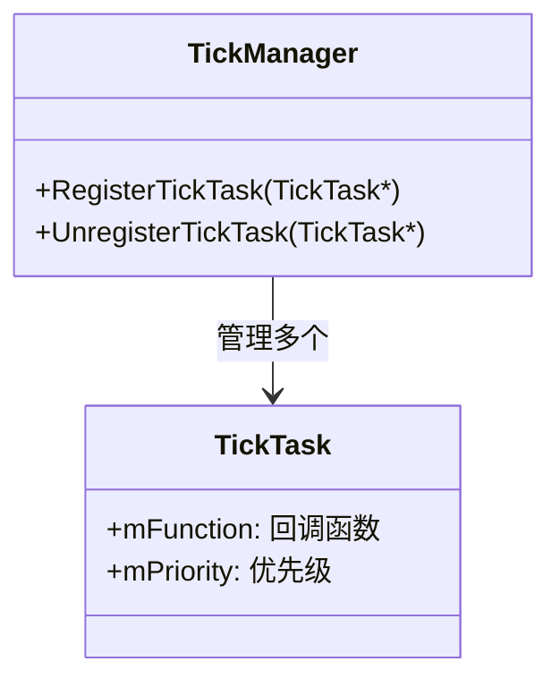
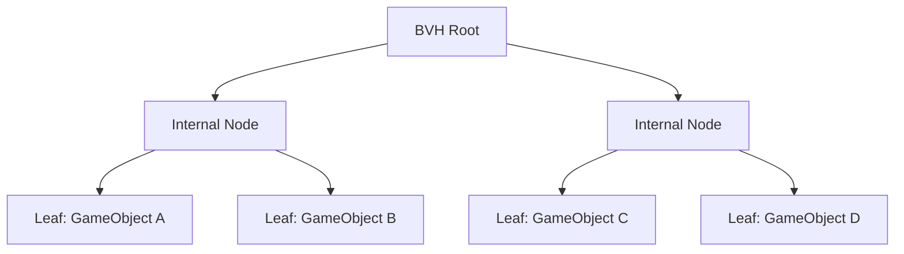

# 游戏逻辑系统架构文档

---

## 1. 概述

Elaine Engine 的游戏逻辑系统位于 **ElaineEngine** 模块，构建在 ElaineCore 之上。采用 **World → Level → GameObject → Component** 的层次结构，结合反射系统实现属性序列化和编辑器集成。

---

## 2. 核心类层次



---

## 3. World 系统

### 3.1 World 生命周期



### 3.2 World 核心功能

| 功能 | 方法 | 描述 |
|------|------|------|
| 帧更新 | `Tick(float dt)` | 驱动所有 TickTask 和 GameObject 更新 |
| 世界持久化 | `SaveWorld()` / `LoadWorld()` | 序列化/反序列化整个世界状态 |
| 关卡管理 | `LoadLevel()` / `UnloadAllLevels()` | 加载/卸载关卡 |
| 分块加载 | `LoadChunk()` / `UnloadChunk()` | 按需加载世界区块 |
| 叠加加载 | `LoadLevelAdditive()` | 在不卸载当前关卡的情况下叠加新关卡 |
| 空间查询 | `Raycast()` / `BoxIntersect()` | 通过 DynamicBVH 进行射线和包围盒查询 |
| 对象创建 | `CreateGameObject()` | 创建并注册 GameObject 到世界 |

### 3.3 分块加载 (Chunk Loading)



World 通过 `mLoadedChunks` (map<string, Level*>) 管理已加载的区块。

---

## 4. GameObject-Component 系统

### 4.1 架构图



### 4.2 组件约束

> **每种类型的组件在一个 GameObject 上只能有一个。**

组件通过 `Name` 类型键存储在 `std::map<Name, Component*>` 中，保证唯一性。

### 4.3 组件生命周期



### 4.4 组件工厂 (ComponentFactory)

```cpp
// 通过类型名称创建组件
Component* AddComponent(const Name& InType);

// 模板方式创建
template<typename ComponentType>
ComponentType* AddComponentType(const Name& InType);

// 模板方式获取
template<typename ComponentType>
ComponentType* GetComponent();
```

### 4.5 空间层次 (Scene Graph)

GameObject 支持父子层次结构：

```
Root GameObject
├── Child A
│   ├── Grandchild A1
│   └── Grandchild A2
├── Child B
└── Child C
```

- `AddChildGameObject()` — 添加子对象
- `CreateChildGameObject()` — 创建并添加子对象
- `mParent` — 父对象引用
- `UpdateNode(childUpdate, notifyParent)` — 递归更新变换

### 4.6 ISpatialObject 接口

GameObject 实现了 `ISpatialObject` 接口，用于空间索引：

```cpp
class ISpatialObject {
    virtual AxisAlignedBox GetBoundingBox() const = 0;
    virtual void* GetUserData() const = 0;
    virtual uint32_t GetUserType() const = 0;  // 1 = GameObject
    virtual void SetBVHNodeID(int32_t) = 0;
    virtual int32_t GetBVHNodeID() const = 0;
};
```

---

## 5. 反射集成

### 5.1 ECLASS 标记

```cpp
ECLASS(DisplayName = "Game Object")
class ElaineEngineExport GameObject : public ISpatialObject
{
    GENERATED_BODY()
    // ...
    
    EPROPERTY(DisplayName="Name", Category="GameObject", 
              Tooltip="The name of this game object")
    std::string mName;
    
    EFUNCTION(DisplayName="Set Name", Category="GameObject")
    void SetName(const std::string& InName);
    
    EFUNCTION(DisplayName="Add World Offset", Category="Transform")
    void AddWorldOffset(const Vector3& InDelta, bool InRecursive = true);
};
```

### 5.2 反射元数据

| 元数据键 | 用途 | 示例 |
|----------|------|------|
| `DisplayName` | 编辑器显示名称 | `"Game Object"` |
| `Category` | 属性分组类别 | `"Transform"` |
| `Tooltip` | 鼠标悬停提示 | `"The name of this game object"` |
| `Transient` | 不序列化 | — |
| `Hidden` | 编辑器中隐藏 | — |
| `ReadOnly` | 编辑器中只读 | — |

### 5.3 序列化

通过 `ElaineSerializer` 基于反射系统自动序列化：
- `GameObjectInfo` 负责导入/导出 GameObject 描述数据
- `ComponentInfo` 负责导入/导出组件描述数据
- 数据格式为 JSON (nlohmann/json)

---

## 6. Viewport 系统



- `Viewport` — 引擎层视口，持有 RenderView
- `RenderView` — 核心层渲染视图，绑定 Camera + SceneManager + RenderTarget
- 支持分屏渲染 (`ViewportRegion`)

---

## 7. Tick 系统



World 每帧调用 `Tick(dt)`，驱动 TickManager 执行所有已注册的 TickTask。

---

## 8. 空间查询系统

### 8.1 DynamicBVH

动态包围盒层次结构 (Bounding Volume Hierarchy)，用于高效空间查询：



### 8.2 查询接口

| 方法 | 描述 |
|------|------|
| `World::Raycast(Ray, MaxDistance)` | 射线检测，返回最近的 ISpatialObject |
| `World::BoxIntersect(AxisAlignedBox)` | 包围盒相交查询，返回所有相交对象 |
| `SceneManager::Raycast(Ray, MaxDistance)` | 渲染代理级别射线检测 |
| `SceneManager::BoxIntersect(MinNDC, MaxNDC, VP)` | NDC 空间框选 |
