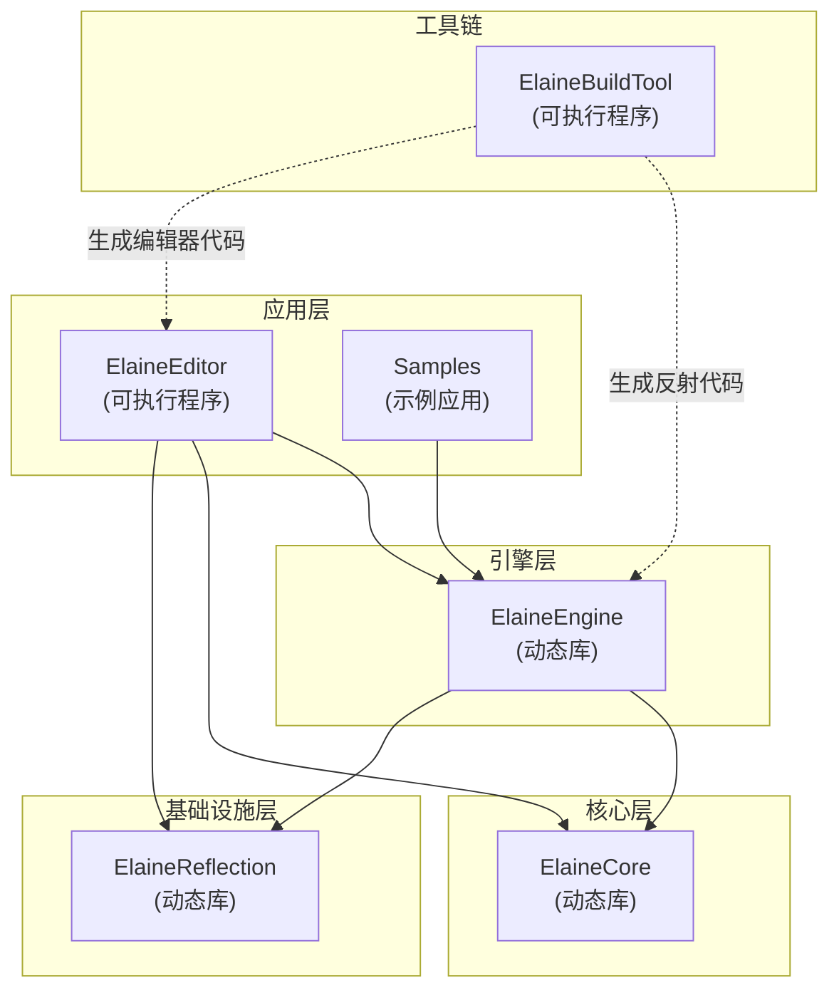
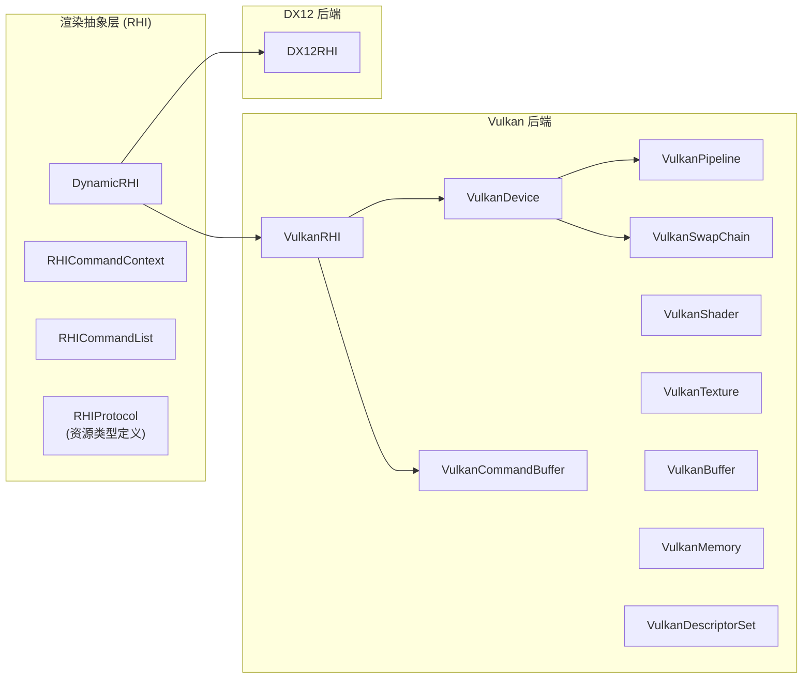
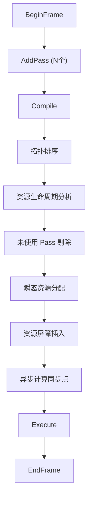
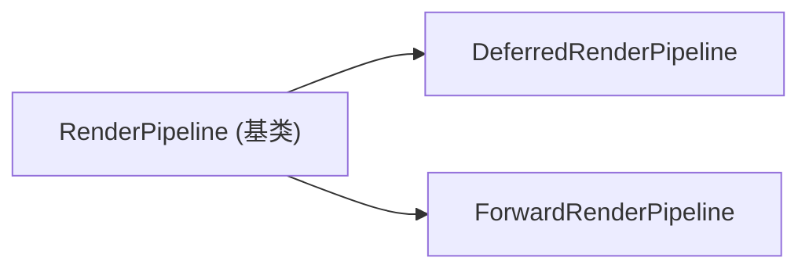
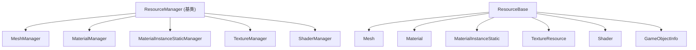
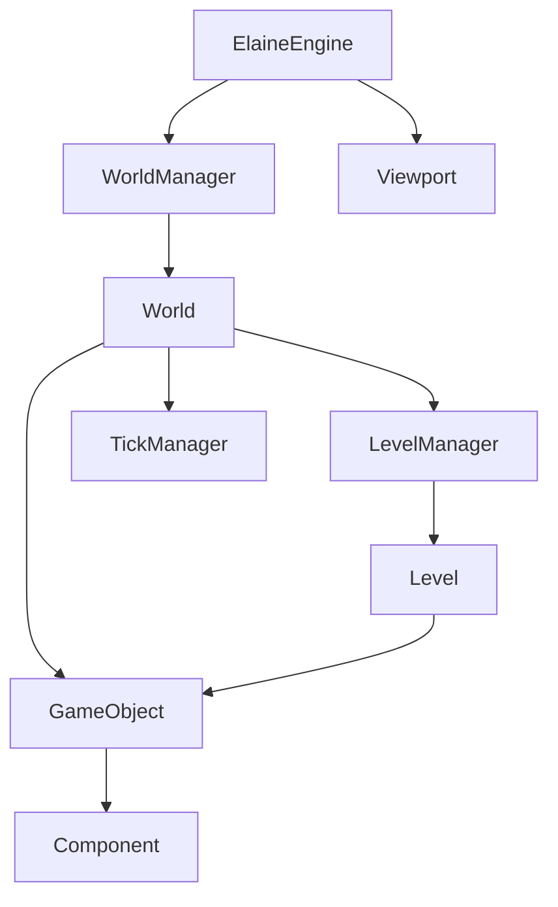
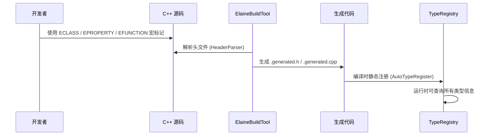
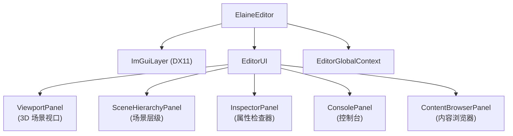
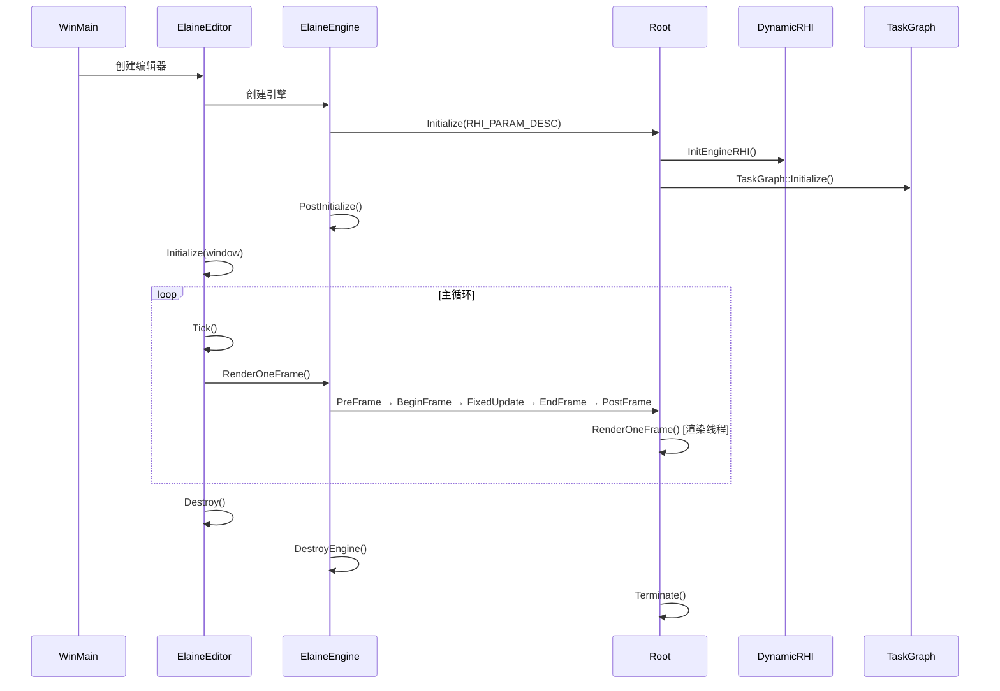

# Elaine Engine — 整体架构文档

---

## 1. 项目概述

Elaine Engine 是一款基于 **C++20** 编写的跨平台游戏引擎，核心渲染后端支持 **Vulkan** 和 **DX12**，未来持续支持其他渲染后端，使用 **CMake** 构建系统。引擎采用分层模块化设计，将底层核心运行时、上层游戏逻辑和编辑器工具清晰分离。

| 特性 | 描述 |
|------|------|
| 语言标准 | C++20 |
| 构建系统 | CMake 3.26+ |
| 渲染后端 | Vulkan（主力）、DX12（进行中）、持续集成 |
| 数学库 | 自研（灵感来源 Geometric Tools） |
| 多线程 | TaskGraph + 命名线程模型 |
| 渲染管线 | RenderGraph 驱动，支持 Deferred / Forward |
| 反射系统 | 自研 ElaineBuildTool 代码生成 |
| 编辑器 | ImGui + DX11 叠加层 |

---

## 2. 模块总览

引擎由以下 **几个主要模块** 组成：



### 2.1 模块依赖关系

| 模块 | 类型 | 依赖 | 职责 |
|------|------|------|------|
| **ElaineReflection** | 动态库 (DLL) | nlohmann/json | 反射类型系统运行时，TypeDescriptor / TypeRegistry |
| **ElaineCore** | 动态库 (DLL) | Vulkan SDK,  spdlog, assimp, stb | 渲染系统、资源管理、场景管理、线程管理、数学库、平台抽象 |
| **ElaineEngine** | 动态库 (DLL) | ElaineCore, ElaineReflection | 游戏逻辑层：World、Level、GameObject、Component 体系 |
| **ElaineEditor** | 可执行程序 (EXE) | ElaineCore, ElaineEngine, ElaineReflection, ImGui, DX11 | 编辑器 UI，场景编辑，属性面板，内容浏览器 |
| **ElaineBuildTool** | 可执行程序 (EXE) | cppast, libclang | 解析 C++ 头文件，生成反射元数据代码 |
| **Samples** | 可执行程序 (EXE) | ElaineEngine | 示例游戏客户端 |

### 2.2 构建配置

引擎定义了 **4 种构建配置**：

| 配置 | 宏定义 | 用途 |
|------|--------|------|
| EditorDebug | `_HAS_EDITOR_`, `_DEBUG` | 编辑器调试模式 |
| EditorRelease | `_HAS_EDITOR_`, `_NODEBUG` | 编辑器发布模式 |
| RuntimeDebug | `_DEBUG` | 运行时调试模式 |
| RuntimeRelease | `_NODEBUG` | 运行时发布模式 |

---

## 3. 整体架构分层

```
┌─────────────────────────────────────────────────────────┐
│                     应用层 (Application)                  │
│  ┌───────────────────┐   ┌────────────────────────────┐  │
│  │   ElaineEditor    │   │       Samples / Game       │  │
│  │  (ImGui + DX11)   │   │                            │  │
│  └────────┬──────────┘   └─────────────┬──────────────┘  │
├───────────┼────────────────────────────┼─────────────────┤
│                     引擎层 (Engine)                       │
│  ┌────────┴────────────────────────────┴──────────────┐  │
│  │              ElaineEngine                          │  │
│  │  World ─ Level ─ GameObject ─ Component            │  │
│  │  Viewport ─ CameraControl ─ TickManager            │  │
│  └────────────────────────┬──────────────────────────┘  │
├───────────────────────────┼──────────────────────────────┤
│                     核心层 (Core)                         │
│  ┌────────────────────────┴──────────────────────────┐  │
│  │                  ElaineCore                        │  │
│  │  ┌──────────┐ ┌──────────┐ ┌───────────────────┐  │  │
│  │  │ 渲染系统  │ │ 资源管理  │ │   场景管理         │  │  │
│  │  │ RHI      │ │ Resource │ │   SceneManager    │  │  │
│  │  │ Vulkan   │ │ Mesh     │ │   QuadTree        │  │  │
│  │  │ DX12     │ │ Material │ │   RenderProxy     │  │  │
│  │  └──────────┘ │ Texture  │ └───────────────────┘  │  │
│  │  ┌──────────┐ │ Shader   │ ┌───────────────────┐  │  │
│  │  │ 多线程    │ └──────────┘ │   渲染管线         │  │  │
│  │  │TaskGraph │               │   RenderGraph     │  │  │
│  │  │ThreadMgr │               │   Deferred/Fwd    │  │  │
│  │  └──────────┘               └───────────────────┘  │  │
│  │  ┌──────────┐ ┌──────────┐ ┌───────────────────┐  │  │
│  │  │ 数学库    │ │ 平台抽象  │ │   文件系统         │  │  │
│  │  │Vector/Mat│ │ Window   │ │   DataStream      │  │  │
│  │  │Quaternion│ │ Input    │ │   FileManager     │  │  │
│  │  └──────────┘ └──────────┘ └───────────────────┘  │  │
│  └───────────────────────────────────────────────────┘  │
├──────────────────────────────────────────────────────────┤
│                   基础设施层 (Infrastructure)              │
│  ┌───────────────────┐  ┌────────────────────────────┐  │
│  │  ElaineReflection │  │     ElaineBuildTool        │  │
│  │  TypeDescriptor   │  │     HeaderParser           │  │
│  │  TypeRegistry     │  │     CodeGenerator          │  │
│  │  Serializer       │  │                            │  │
│  └───────────────────┘  └────────────────────────────┘  │
├──────────────────────────────────────────────────────────┤
│                   第三方库 (ThirdParty)                    │
│  Vulkan SDK │ VMA │ GLFW │ spdlog │ assimp │ stb        │
│  ImGui │ ImGuizmo │ cJSON │ nlohmann/json │ cppast      │
└──────────────────────────────────────────────────────────┘
```

---

## 4. ElaineCore — 核心层详细架构

ElaineCore 是引擎的基础核心库，包含以下子系统：

### 4.1 渲染系统 (Render)



**关键类：**
- `DynamicRHI` — RHI 抽象基类，提供 `Initialize`, `CreateCommandContex` 等接口
- `RHICommandContext` — 渲染命令上下文（Graphics / Compute / Transfer）
- `RHICommandList` — 渲染命令列表，封装绘制、资源绑定等操作
- `VulkanRHI` — Vulkan 后端实现，管理 Instance / Device / SwapChain 等

### 4.2 RenderGraph 系统

帧图 (Frame Graph) 驱动的渲染管线：



**核心特性：**
- 瞬态 (Transient) / 持久 (Persistent) / 外部导入 (Import) 三种资源模式
- 自动资源屏障插入
- 异步计算同步
- Pass 自动剔除（未引用的 Pass 被裁剪）
- 资源提取（跨帧数据，如 TAA 历史帧）
- 统计信息与调试导出

### 4.3 渲染管线 (Render Pipeline)



**延迟渲染管线流程 (UE5 风格)：**

| 阶段 | 描述 |
|------|------|
| VT Feedback Pass | 虚拟纹理反馈（可选） |
| VT CPU Update | 分析反馈，流式加载 tile |
| Shadow Pass | 渲染阴影贴图 |
| GBuffer Pass | 输出 BaseColor+M, Normal+R, Emissive+AO, Depth |
| Deferred Lighting | 全屏 PBR 光照 |
| Transparent Forward | 前向渲染半透明物体 |
| Post Process | Tone Mapping, Bloom 等后处理 |
| Copy to BackBuffer | 最终 Blit 到交换链 |

**GBuffer 布局：**

| RT | 格式 | 通道内容 |
|----|------|----------|
| RT0 | RGBA8 | BaseColor.rgb + Metallic.a |
| RT1 | RGBA16F | WorldNormal.rgb + Roughness.a |
| RT2 | RGBA8 | Emissive.rgb + AO.a |
| Depth | D32F | Scene Depth |

### 4.4 场景管理 (Scene Management)

- `SceneManager` — 管理场景中的渲染代理 (RenderProxy)、相机和渲染队列
- `QuadTree` — 四叉树空间划分，用于可见性剔除
- `RenderProxy` — 渲染代理基类，子类包括：
  - `MeshRenderProxy` — 静态网格渲染
  - `SkyRenderProxy` — 天空渲染
  - `GridRenderProxy` — 编辑器网格
  - `TessellationRenderProxy` — 细分曲面
- `RenderView` — 渲染视图，绑定 Camera + SceneManager + RenderTarget
- `Camera` — 相机系统，支持多相机、阴影相机

场景查询支持：
- `Raycast` — 射线检测
- `BoxIntersect` — NDC 空间框选

### 4.5 资源管理 (Resource Management)



**资源生命周期状态机：**

```
Unloaded → Pending → Loading → Loaded
                               ↓
                           Unloading → Unloaded
                               ↓
                             Failed / Missing
```

**特性：**
- 异步/同步加载（TaskGraph 驱动）
- 引用计数智能指针 `ResourcePtr<T>`
- 加载完成回调
- 资源依赖追踪

### 4.6 多线程系统 (Threading)

**命名线程模型：**

| 线程类型 | 用途 |
|----------|------|
| GameThread | 游戏逻辑主线程 |
| RenderThread | 渲染逻辑线程 |
| RHIThread | 渲染 API 命令线程 |
| TaskThread0-7 | TaskGraph 工作线程池 |
| GeneralThread0-2 | 通用工作线程 |
| ScheduleThread | TaskGraph 调度器线程 |

**TaskGraph 系统：**
- 基于 DAG 的任务依赖图
- 支持任务链与依赖关系
- Worker Pool + TaskScheduler 调度
- 支持绑定到特定命名线程执行

**逻辑-渲染线程同步：**
- `LogicToRender_Barrier` / `RenderToLogic_Barrier` — 双 Barrier 同步机制

### 4.7 数学库 (Math)

自研数学库，包含：
- `Vector2`, `Vector3`, `Vector4`
- `Matrix3x3`, `Matrix4x4`
- `Quaternion`
- `Transform`
- `Ray`, `AxisAlignedBox`
- `DynamicBVH` — 动态包围盒层次结构
- `ISpatialObject` — 空间对象接口
- `Random` — 随机数生成

### 4.8 平台抽象 (Platform)

- `PlatformWindow` — CRTP 模式的跨平台窗口抽象
- 支持 Windows（GLFW 实现）、Linux（计划中）
- 窗口事件系统（Resize, Close, Focus 等）
- 输入系统 (`InputSystem`)

---

## 5. ElaineEngine — 引擎层详细架构

### 5.1 核心类关系



### 5.2 游戏对象系统 (GameObject-Component)

引擎采用 **组件模式 (Component Pattern)**：

- `GameObject` — 游戏对象，持有 Transform + 各类 Component
- `Component` — 组件基类，虚函数：`OnCreate`, `OnDestroy`, `OnUpdate`, `OnRegisterWorld`
- 组件类型：
  - `TransformComponent` — 变换组件
  - `MeshComponent` — 网格渲染组件
  - `CameraComponent` — 相机组件
  - `SkyComponent` — 天空盒组件
- `ComponentFactory` — 组件工厂，按 Name 创建组件实例

**每个 GameObject 同一类型组件只能持有一个。**

### 5.3 World-Level 体系

- `World` — 游戏世界，管理多个 Level、GameObject 列表、BVH 空间索引
  - 支持 `SaveWorld` / `LoadWorld` 持久化
  - 支持 `LoadChunk` / `UnloadChunk` 分块加载
  - 支持 `Raycast` 和 `BoxIntersect` 空间查询
- `Level` — 关卡，可叠加加载 (`LoadLevelAdditive`)
- `TickManager` — Tick 任务管理器

---

## 6. ElaineReflection — 反射系统架构

### 6.1 反射工作流



### 6.2 核心概念

| 类型 | 职责 |
|------|------|
| `ECLASS()` | 标记一个类需要反射 |
| `EPROPERTY(...)` | 标记属性，支持 DisplayName, Category, Tooltip, Transient, Hidden, ReadOnly 等元数据 |
| `EFUNCTION(...)` | 标记函数 |
| `GENERATED_BODY()` | 展开为 StaticClass / GetClass / StaticClassName 等方法 |
| `TypeDescriptor` | 运行时类型描述器，持有属性和函数描述 |
| `TypeRegistry` | 全局单例注册表，按类名查询 TypeDescriptor |
| `PropertyDescriptor` | 属性描述（名称、类型、偏移量、元数据） |
| `FunctionDescriptor` | 函数描述（名称、返回值、参数列表） |
| `ElaineSerializer` | 基于反射的序列化工具 |

### 6.3 ElaineBuildTool

代码生成工具，编译前自动执行：
- `HeaderParser` — 解析带有 ECLASS / EPROPERTY / EFUNCTION 宏的头文件
- `CodeGenerator` — 生成：
  - `*.generated.h` — GENERATED_BODY 宏定义
  - `*.generated.cpp` — 静态注册代码
  - `*.editor.generated.cpp` — 编辑器特定代码（Property Drawer 注册等）

---

## 7. ElaineEditor — 编辑器架构

### 7.1 编辑器面板



**关键模块：**
- `ImGuiLayer` — ImGui DX11 后端初始化与帧管理
- `EditorGlobalContext` — 编辑器全局状态上下文
- `EditorCameraController` — 编辑器相机控制器
- `EditorGridManager` — 场景网格管理
- `PropertyDrawer` — 反射驱动的属性绘制系统
- `PropertyDrawerRegistry` — 属性绘制器注册表

### 7.2 渲染架构

编辑器使用 **双渲染上下文** 架构：
- **引擎渲染**：Vulkan 离屏渲染 → OffscreenRenderTarget
- **编辑器 UI**：DX11 + ImGui → 窗口 SwapChain
- 引擎渲染结果作为纹理传递给 ImGui 的 ViewportPanel 显示

---

## 8. 内容资产 (Contents)

```
Contents/
├── config/              # 引擎配置文件
├── material/            # 材质定义
├── material_instance/   # 材质实例
├── model/               # 3D 模型资源
├── render/              # 渲染配置
├── shader/              # 着色器源码
├── texture/             # 纹理资源
└── worlds/              # 世界/关卡存档
```

---

## 9. 第三方库依赖

| 库 | 用途 |
|----|------|
| Vulkan SDK | 主力渲染 API |
| VulkanMemoryAllocator (VMA) | GPU 内存管理 |
| GLFW | 跨平台窗口与输入 |
| spdlog | 日志系统 |
| assimp | 3D 模型导入 |
| stb | 图片加载 (stb_image) |
| ImGui | 编辑器即时模式 UI |
| ImGuizmo | 3D Gizmo 操作 |
| cJSON | JSON 解析（旧接口） |
| nlohmann/json | JSON 解析（新接口） |
| cppast + libclang | C++ 头文件解析（ElaineBuildTool 使用） |

---

## 10. 引擎生命周期



---

## 11. 设计亮点与未来规划

### 设计亮点
1. **RenderGraph 驱动**：自动资源管理、屏障插入、异步计算同步
2. **反射代码生成**：类似 UE 的 ECLASS/EPROPERTY 宏体系，编译前自动生成
3. **多线程架构**：TaskGraph 任务图 + 命名线程模型，游戏/渲染/RHI 线程分离
4. **延迟渲染管线**：UE5 风格 GBuffer 布局，支持虚拟纹理
5. **空间查询**：四叉树 + 动态 BVH，支持射线检测与框选
6. **资源异步加载**：TaskGraph 驱动，引用计数 + 依赖追踪

### 未来规划
- Linux / Android / iOS 平台支持
- DX12 后端完善
- 更完善的 TaskGraph 事件通知机制
- 脚本系统集成
- 物理系统集成
- 音频系统
