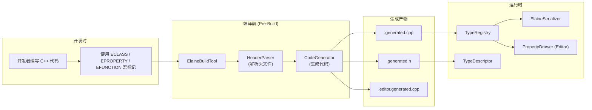
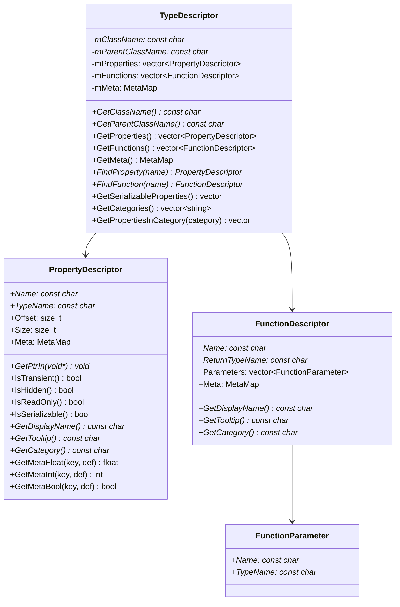
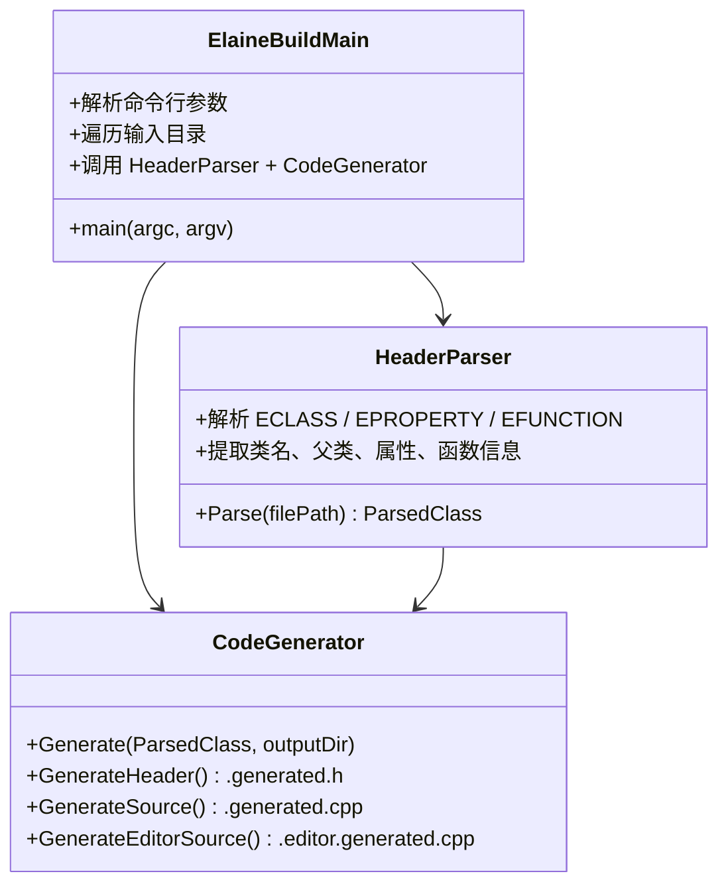
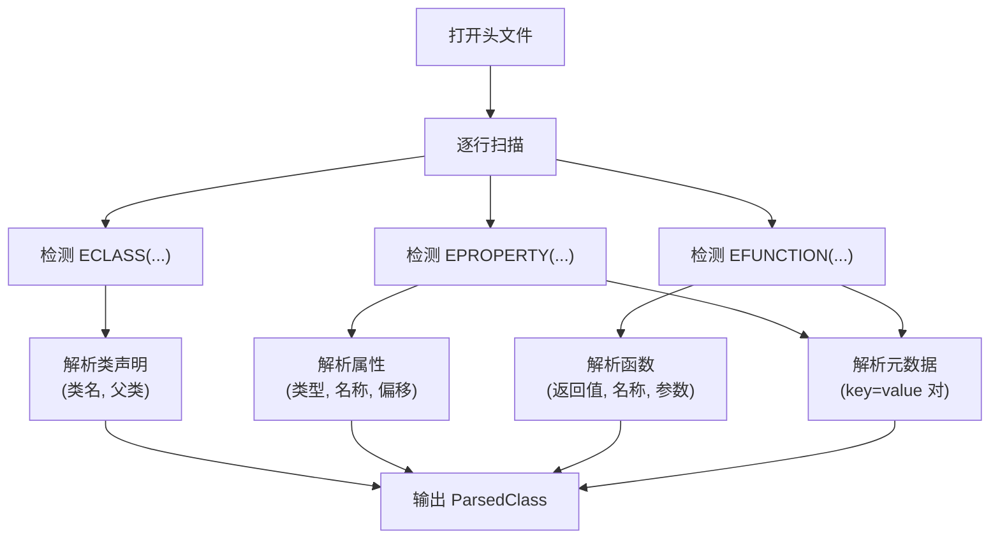
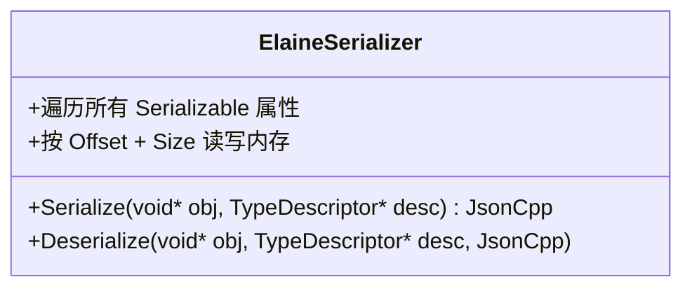
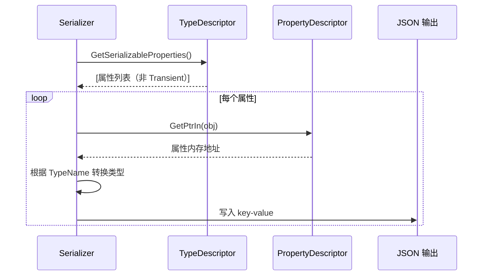
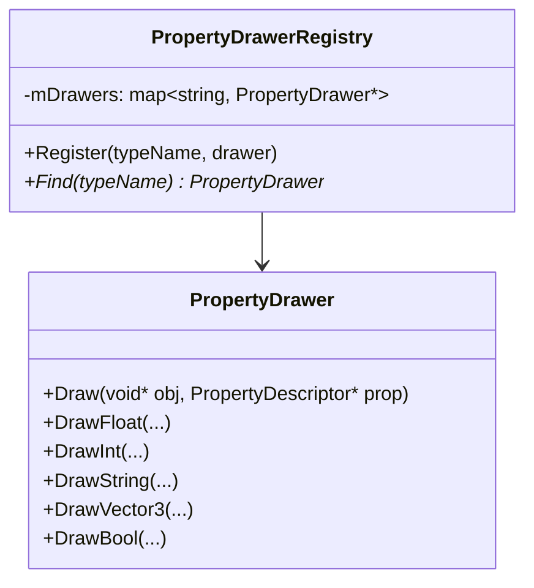
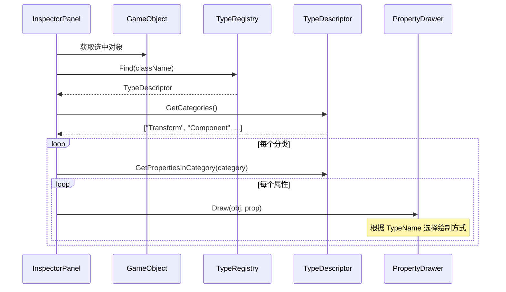
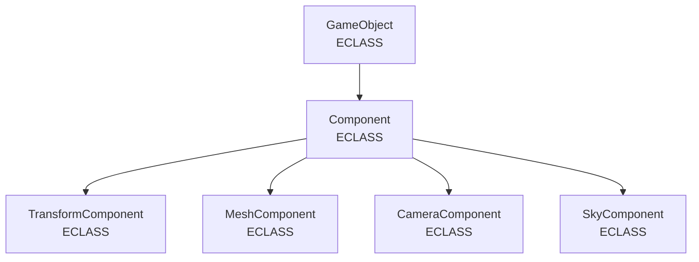

# 反射系统与代码生成架构文档

---

## 1. 概述

Elaine Engine 实现了一套类似 Unreal Engine 的反射系统，由 **ElaineReflection** 运行时库和 **ElaineBuildTool** 代码生成工具组成。开发者通过宏标记 (`ECLASS`, `EPROPERTY`, `EFUNCTION`) 声明反射信息，ElaineBuildTool 在编译前自动解析头文件并生成反射元数据代码。

---

## 2. 整体工作流



---

## 3. 反射宏定义

所有宏定义在 `ElaineReflectionDefines.h` 中，**对编译器来说是空操作 (no-op)**，仅作为 ElaineBuildTool 的解析标记：

### 3.1 ECLASS

```cpp
#define ECLASS(...)

// 用法：
ECLASS(DisplayName = "Game Object")
class ElaineEngineExport GameObject : public ISpatialObject
{
    GENERATED_BODY()
    // ...
};
```

标记一个类需要反射。支持的元数据参数：

| 参数 | 描述 |
|------|------|
| `DisplayName` | 编辑器中显示的类名 |

### 3.2 EPROPERTY

```cpp
#define EPROPERTY(...)

// 用法：
EPROPERTY(DisplayName="Name", Category="GameObject", 
          Tooltip="The name of this game object")
std::string mName;
```

标记一个属性需要反射。支持的元数据参数：

| 参数 | 类型 | 描述 |
|------|------|------|
| `DisplayName` | string | 编辑器中显示的属性名 |
| `Category` | string | 属性面板中的分组类别 |
| `Tooltip` | string | 鼠标悬停提示文本 |
| `Transient` | flag | 标记为不序列化 |
| `Hidden` | flag | 在编辑器中隐藏 |
| `ReadOnly` | flag | 在编辑器中只读 |

### 3.3 EFUNCTION

```cpp
#define EFUNCTION(...)

// 用法：
EFUNCTION(DisplayName="Set Name", Category="GameObject")
void SetName(const std::string& InName);

EFUNCTION(DisplayName="Add World Offset", Category="Transform")
void AddWorldOffset(const Vector3& InDelta, bool InRecursive = true);
```

标记一个函数需要反射。支持的元数据参数：

| 参数 | 类型 | 描述 |
|------|------|------|
| `DisplayName` | string | 编辑器中显示的函数名 |
| `Category` | string | 分组类别 |
| `Tooltip` | string | 提示文本 |

### 3.4 GENERATED_BODY

```cpp
#ifndef GENERATED_BODY
#define GENERATED_BODY()
#endif
```

默认为空宏。`.generated.h` 文件会 `#undef` 并重新定义此宏，展开为：
- `static TypeDescriptor* StaticClass()` — 获取类型描述器
- `virtual TypeDescriptor* GetClass()` — 获取实例的类型描述器
- `static const char* StaticClassName()` — 获取类名字符串

---

## 4. ElaineReflection 运行时库

### 4.1 TypeDescriptor



### 4.2 TypeRegistry

全局单例，管理所有已注册的 TypeDescriptor：

```cpp
class TypeRegistry {
public:
    static TypeRegistry& Instance();
    void Register(TypeDescriptor* desc);
    TypeDescriptor* Find(const char* className) const;
    TypeDescriptor* Find(const std::string& className) const;
    const std::unordered_map<std::string, TypeDescriptor*>& GetAllTypes() const;
};
```

### 4.3 AutoTypeRegister

静态初始化辅助结构，用于在程序启动时自动注册类型：

```cpp
struct AutoTypeRegister {
    AutoTypeRegister(TypeDescriptor* desc) {
        TypeRegistry::Instance().Register(desc);
    }
};
```

生成代码中使用方式：
```cpp
// 自动注册，利用全局静态变量的构造函数
static AutoTypeRegister __register_GameObject(&__desc_GameObject);
```

### 4.4 PropertyDescriptor 便利接口

```cpp
// 通过 void* 基指针读取属性值
void* GetPtrIn(void* obj) const {
    return static_cast<char*>(obj) + Offset;
}

// 判断属性特性
bool IsTransient() const;    // 不序列化
bool IsHidden() const;       // 编辑器隐藏
bool IsReadOnly() const;     // 编辑器只读
bool IsSerializable() const; // 可序列化 (= !Transient)

// 获取元数据
const char* GetDisplayName() const;
const char* GetTooltip() const;
const char* GetCategory() const;
float GetMetaFloat(key, defaultValue) const;
int GetMetaInt(key, defaultValue) const;
bool GetMetaBool(key, defaultValue) const;
```

---

## 5. ElaineBuildTool 代码生成工具

### 5.1 架构



### 5.2 命令行参数

ElaineBuildTool 通过 CMake `add_custom_command` 在编译前自动执行：

```
ElaineBuildTool
    --input <源码目录>           # 要扫描的头文件目录
    --output <输出目录>          # .generated.h/.cpp 输出位置
    --editor-output <编辑器输出> # .editor.generated.cpp 输出位置
    --include <包含路径>         # 额外的 include 搜索路径（可重复）
```

### 5.3 生成产物

| 文件 | 描述 | 示例 |
|------|------|------|
| `*.generated.h` | GENERATED_BODY 宏重定义，声明 StaticClass / GetClass | `ElaineGameObject.generated.h` |
| `*.generated.cpp` | TypeDescriptor 构建代码 + AutoTypeRegister 注册 | `ElaineGameObject.generated.cpp` |
| `*.editor.generated.cpp` | 编辑器特定代码（PropertyDrawer 注册等） | `ElaineGameObject.editor.generated.cpp` |

### 5.4 构建集成

在 `ElaineEngine/CMakeLists.txt` 中：
```cmake
add_custom_command(
    TARGET ElaineEngine PRE_BUILD
    COMMAND $<TARGET_FILE:ElaineBuildTool>
        --input "${CMAKE_CURRENT_SOURCE_DIR}/Public"
        --output "${CMAKE_CURRENT_SOURCE_DIR}/Generated"
        --editor-output "${CMAKE_SOURCE_DIR}/ElaineEditor/Generated"
        --include ...
    DEPENDS ElaineBuildTool
)
```

在 `ElaineEditor/CMakeLists.txt` 中同样配置了 PRE_BUILD 步骤。

### 5.5 HeaderParser 解析流程



---

## 6. 序列化系统 (ElaineSerializer)

`ElaineSerializer` 基于反射系统实现自动序列化/反序列化：



### 6.1 序列化流程



### 6.2 GameObjectInfo 序列化

```cpp
class GameObjectInfo : public ResourceBase {
    void ImportData(const JsonCpp& jsonNode); // 从 JSON 反序列化
    void ExportData(JsonCpp& jsonNode);       // 序列化到 JSON
    void ExportToFile();                      // 导出到文件
};
```

---

## 7. 编辑器集成

### 7.1 PropertyDrawer 系统

反射驱动的属性绘制系统，自动为反射属性生成 ImGui 编辑控件：



### 7.2 InspectorPanel

Inspector 面板通过反射自动展示 GameObject 和 Component 的属性：



---

## 8. 已反射的类层次



每个 ECLASS 标记的类都会生成对应的 `.generated.h` 和 `.generated.cpp` 文件，自动注册到 TypeRegistry。
