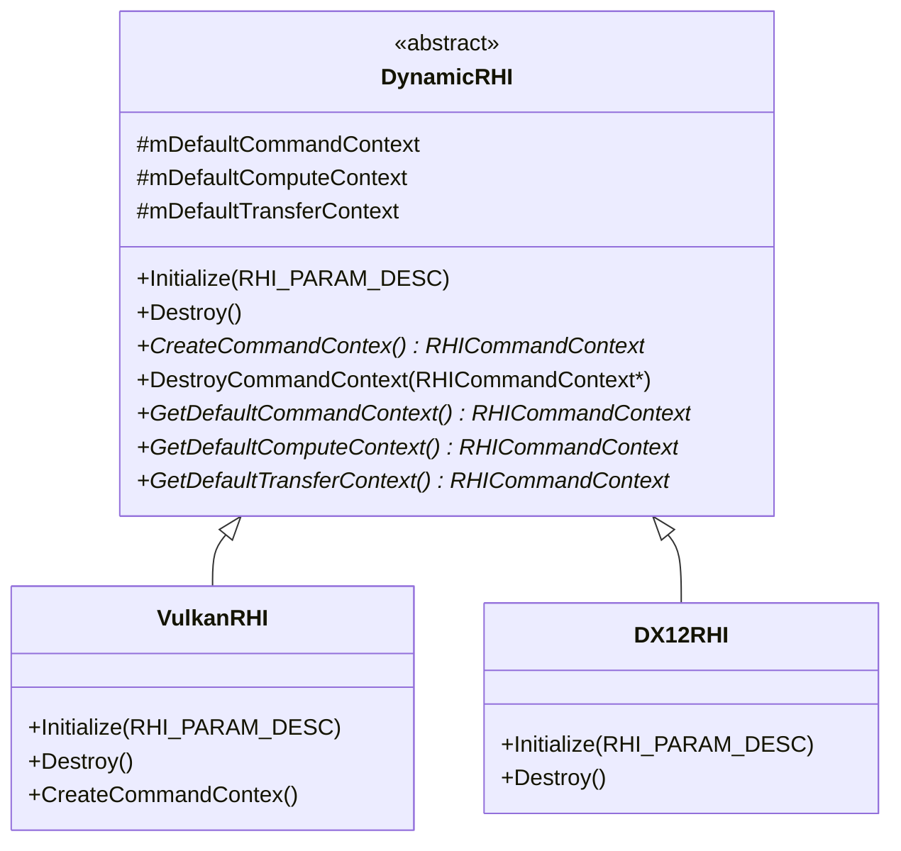
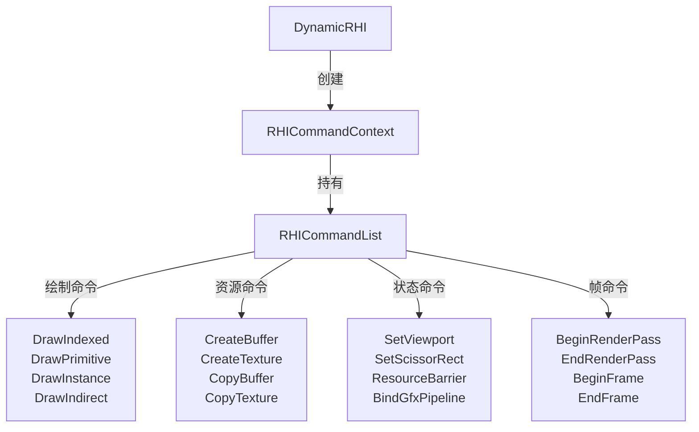
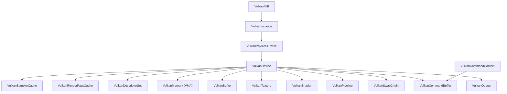
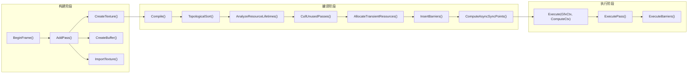
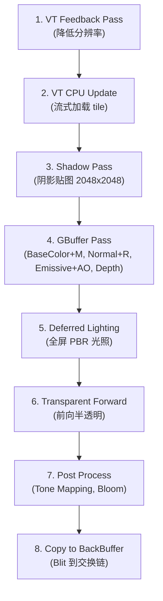
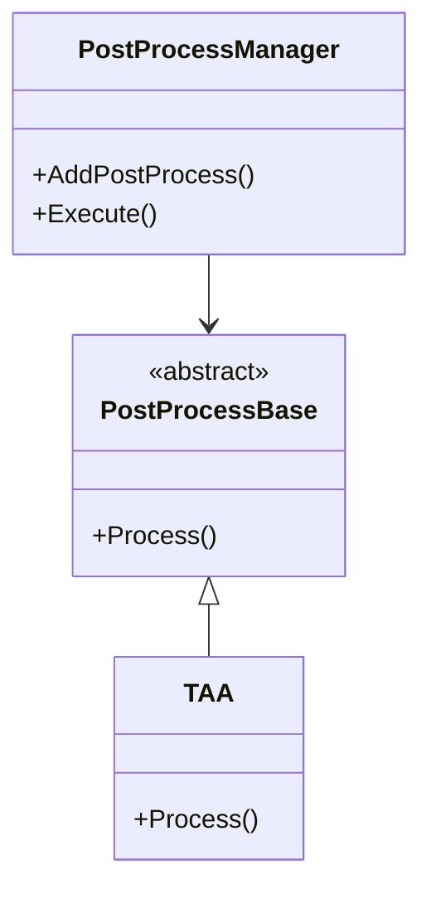
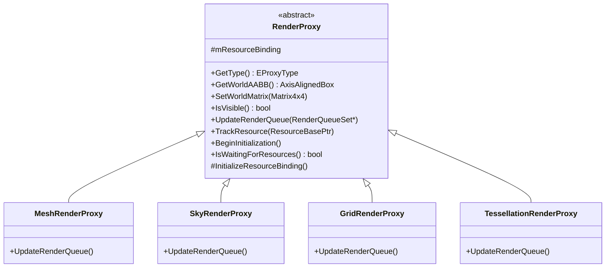
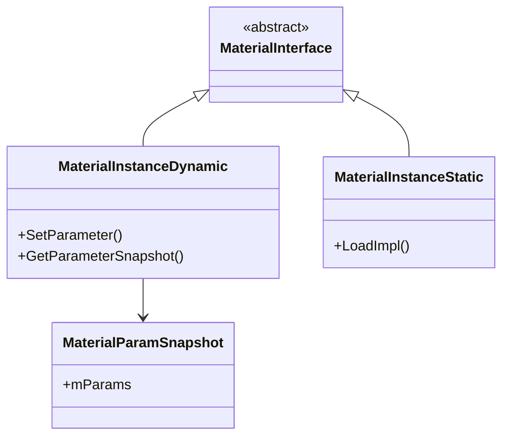
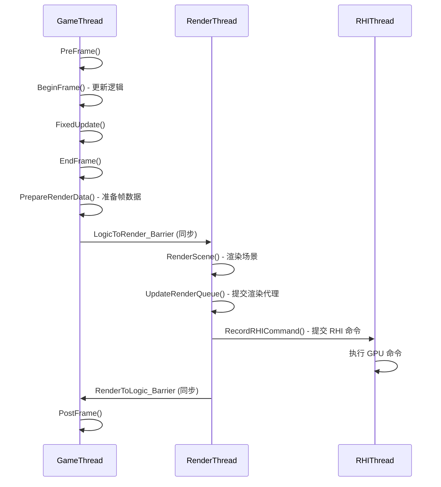
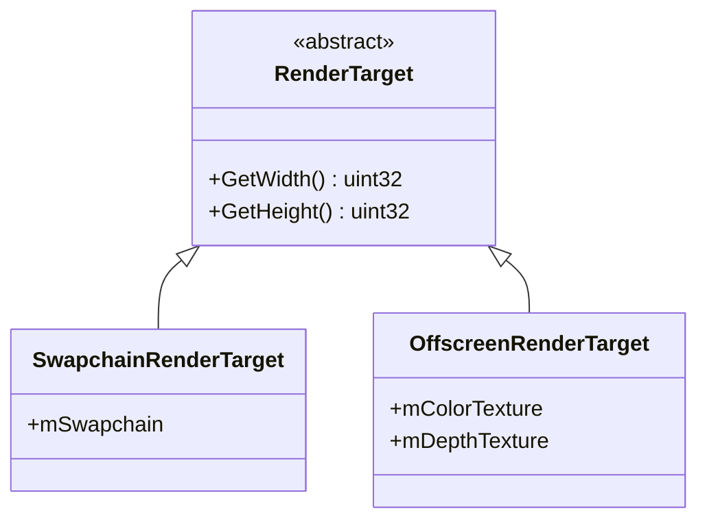

# 渲染系统架构文档

---

## 1. 概述

Elaine Engine 的渲染系统采用 **RHI 抽象层 + 多后端** 设计，目前主力后端为 **Vulkan**（通过 Volk 动态加载），DX12 后端处于开发中。渲染管线由 **RenderGraph** 驱动，支持 **延迟渲染 (Deferred)** 和 **前向渲染 (Forward)** 两种模式。

---

## 2. RHI 抽象层

### 2.1 核心类层次



### 2.2 RHI 支持的后端

| 后端 | 枚举值 | 状态 |
|------|--------|------|
| Vulkan | `ERHI_TYPE::Vulkan` | ✅ 主力后端 |
| DirectX 12 | `ERHI_TYPE::DirectX12` | 🚧 开发中 |
| DirectX 11 | `ERHI_TYPE::DirectX11` | ⚠️ 仅编辑器 ImGui |
| Metal | `ERHI_TYPE::Metal` | 📋 计划中 |
| OpenGL | `ERHI_TYPE::OpenGl` | 📋 计划中 |

### 2.3 RHI 命令体系



**命令上下文类型：**
- `DefaultCommandContext` — 图形命令上下文
- `DefaultComputeContext` — 计算命令上下文
- `DefaultTransferContext` — 传输命令上下文

### 2.4 RHI 资源类型

在 `ElaineRHIProtocol.h` 和 `ElaineRHITypes.h` 中定义了丰富的 RHI 资源类型：

| 类别 | 资源类型 |
|------|----------|
| 缓冲区 | `RHIBuffer`, `RHIUniformBuffer` |
| 纹理 | `RHITexture`, `RHIRenderTexture` |
| 管线 | `RHIPipeline`, `RHIRenderPass` |
| 着色器 | `RHIShader` |
| 交换链 | `RHISwapchain` |
| 采样器 | `RHISampler` |
| 描述符 | `RHIDescriptorSet` |

---

## 3. Vulkan 后端

### 3.1 核心组件



### 3.2 关键实现

| 组件 | 文件 | 职责 |
|------|------|------|
| `VulkanInstance` | `ElaineVulkanInstance.h` | Vulkan 实例创建，验证层管理 |
| `VulkanPhysicalDevice` | `ElaineVulkanPhysicalDevice.h` | 物理设备枚举与选择 |
| `VulkanDevice` | `ElaineVulkanDevice.h` | 逻辑设备管理，队列族管理 |
| `VulkanCommandBuffer` | `ElaineVulkanCommandBuffer.h` | 命令缓冲区封装 |
| `VulkanCommandContext` | `ElaineVulkanCommandContext.h` | Vulkan RHICommandContext 实现 |
| `VulkanPipeline` | `ElaineVulkanPipeline.h` | 图形/计算管线创建与缓存 |
| `VulkanShader` | `ElaineVulkanShader.h` | SPIR-V 着色器加载与管理 |
| `VulkanTexture` | `ElaineVulkanTexture.h` | 纹理创建、布局转换 |
| `VulkanBuffer` | `ElaineVulkanBuffer.h` | 缓冲区管理 |
| `VulkanMemory` | `ElaineVulkanMemory.h` | GPU 内存管理 |
| `VulkanDescriptorSet` | `ElaineVulkanDescriptorSet.h` | 描述符集管理 |
| `VulkanRenderPassCache` | `ElaineVulkanRenderPassCache.h` | RenderPass 缓存池 |
| `VulkanSamplerCache` | `ElaineVulkanSamplerCache.h` | 采样器缓存池 |
| `VulkanSwapChain` | `ElaineVulkanSwapChain.h` | 交换链管理 |
| `VulkanBarrier` | `ElaineVulkanBarrier.h` | 资源屏障管理 |

> **注意：** 引擎使用 **Volk** 动态加载 Vulkan API，而非静态链接 `vulkan-1.lib`。可通过 CMake 选项 `_Use_Volk_` 控制。

---

## 4. RenderGraph 系统

### 4.1 架构概览



### 4.2 资源类型

| 类型 | 创建方法 | 特性 |
|------|----------|------|
| 瞬态纹理 | `CreateTexture()` | 帧末释放，可复用 |
| 瞬态缓冲区 | `CreateBuffer()` | 帧末释放，可复用 |
| 持久纹理 | `CreatePersistentTexture()` | 跨帧保留 |
| 持久缓冲区 | `CreatePersistentBuffer()` | 跨帧保留 |
| 外部纹理 | `ImportTexture()` | 外部已有资源导入 |
| 外部缓冲区 | `ImportBuffer()` | 外部已有资源导入 |
| 纹理别名 | `CreateTextureAlias()` | 资源内存别名 |

### 4.3 资源池 (ResourcePool)

`RenderGraphResourcePool` 管理瞬态资源的分配与回收，减少 GPU 资源创建/销毁开销。

### 4.4 跨帧数据 (Extracted Textures)

用于 TAA 等需要历史帧数据的效果：
- `QueueTextureExtraction()` — 标记当前帧的纹理待提取
- `ImportExtractedTexture()` — 下一帧导入上一帧提取的纹理
- `HasExtractedTexture()` — 查询是否有可用历史帧纹理

### 4.5 调试支持

- `EnableValidation()` — 开启验证模式
- `DumpGraph()` — 导出图结构到文件
- `GetStatistics()` — 获取帧统计信息

---

## 5. 渲染管线

### 5.1 管线基类

```cpp
class RenderPipeline {
    virtual void Initialize() = 0;
    virtual void Render(RenderView* InRenderView) = 0;
};
```

Root 持有 `mRenderPipeline[RP_Count]` 数组，支持多管线切换。

### 5.2 延迟渲染管线 (DeferredRenderPipeline)

**渲染流程：**



**持有的渲染资源：**
- GBuffer A/B/C（BaseColor+Metallic, Normal+Roughness, Emissive+AO）
- Scene Depth Texture
- Shadow Map Texture
- Scene Color Texture（光照输出）
- PostProcessChain

### 5.3 前向渲染管线 (ForwardRenderPipeline)

轻量级前向渲染管线，适用于简单场景或移动端。

---

## 6. 后处理系统 (Post Process)



**已实现效果：**
- TAA (Temporal Anti-Aliasing)

**框架支持扩展：**
- Tone Mapping
- Bloom
- 其他自定义后处理

---

## 7. 渲染代理 (RenderProxy)

渲染代理是逻辑对象到渲染系统的桥梁，负责将游戏对象的渲染数据提交到渲染队列。



**资源追踪机制：**
1. 通过 `TrackResource()` 追踪关联资源（递归追踪依赖）
2. 资源异步加载完成后回调 `OnResourceLoaded()`
3. 所有资源就绪后自动调用 `InitializeResourceBinding()` 初始化绑定
4. 支持线程安全的原子计数 (`mPendingResourceCount`)

---

## 8. 材质系统



- `MaterialInterface` — 材质接口基类
- `MaterialInstanceDynamic` — 运行时可修改参数的材质实例
- `MaterialInstanceStatic` — 预编译的静态材质实例（资源加载）
- `MaterialParamSnapshot` — 材质参数快照
- `ShaderPassManager` — 管理 Shader Pass 编译与缓存
- `UniformGPUManager` — 统一缓冲区 GPU 管理

---

## 9. 渲染线程模型



**双缓冲帧数据：**
- `SceneManager` 持有 `mFrameData[2]`，写入帧和读取帧交替使用
- `mCurrentWriteFrame` 原子变量控制当前写入索引

---

## 10. 渲染目标 (Render Target)



- `SwapchainRenderTarget` — 直接渲染到窗口交换链
- `OffscreenRenderTarget` — 离屏渲染目标（编辑器 Viewport 使用）
