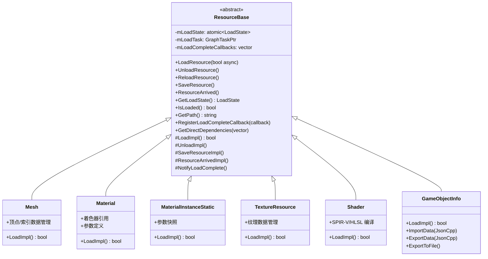
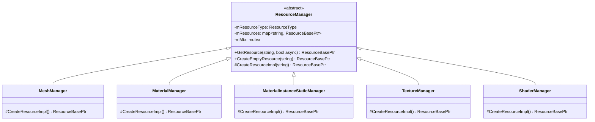
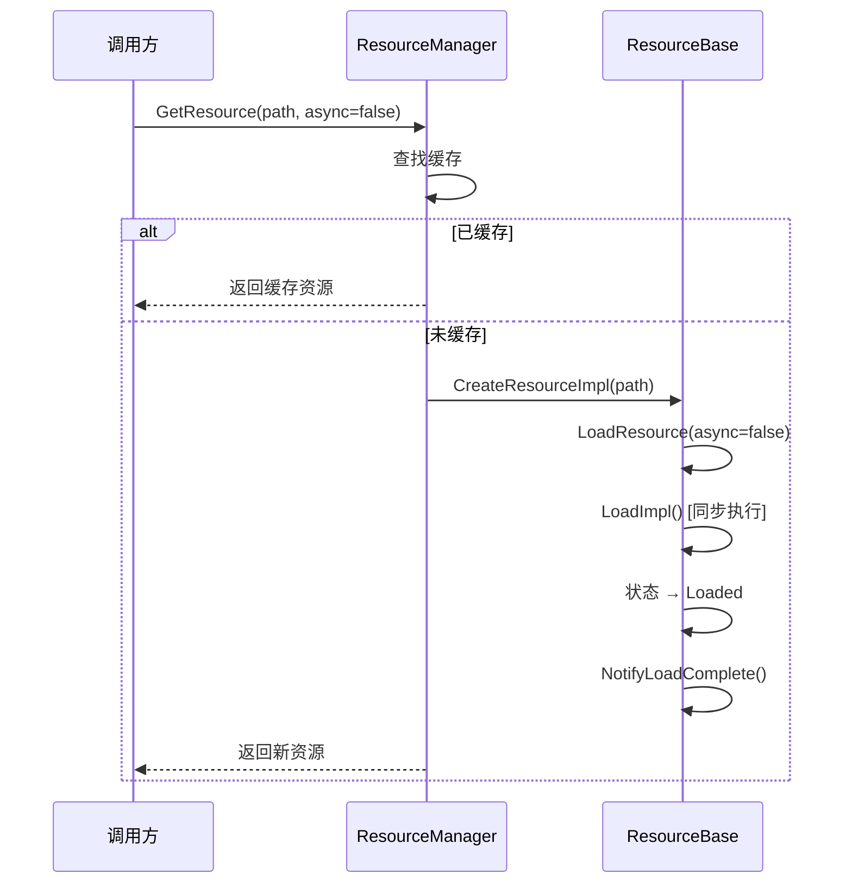
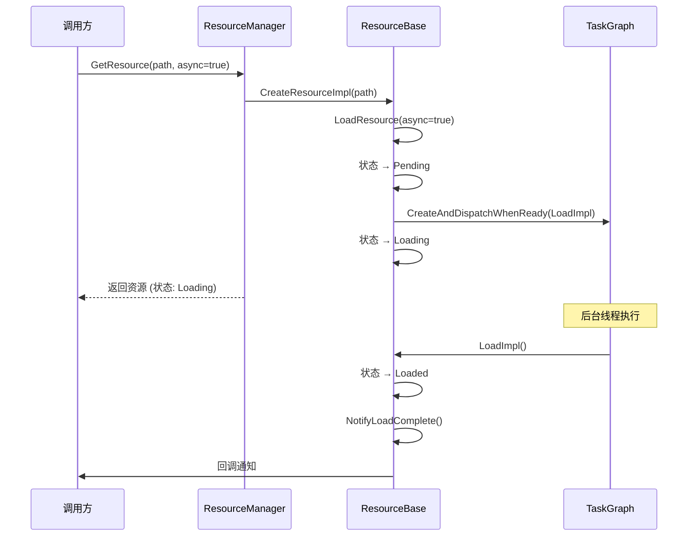
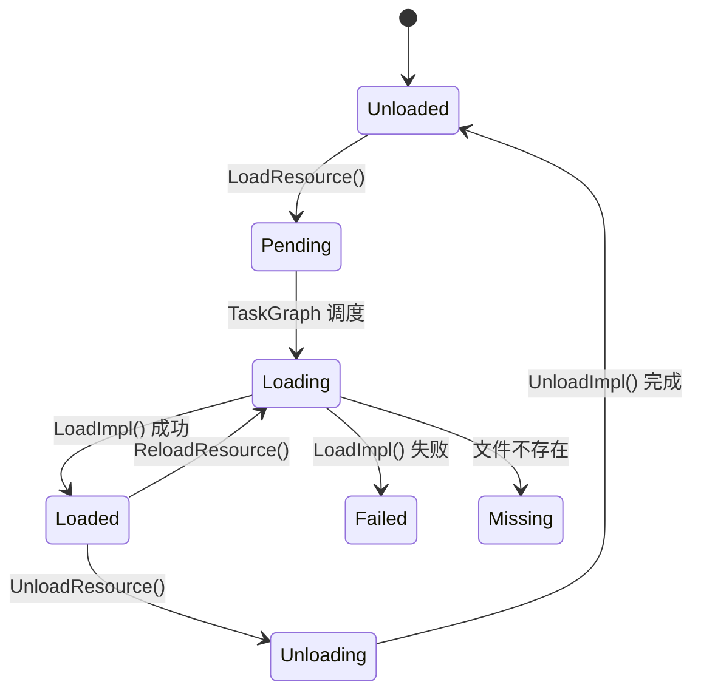
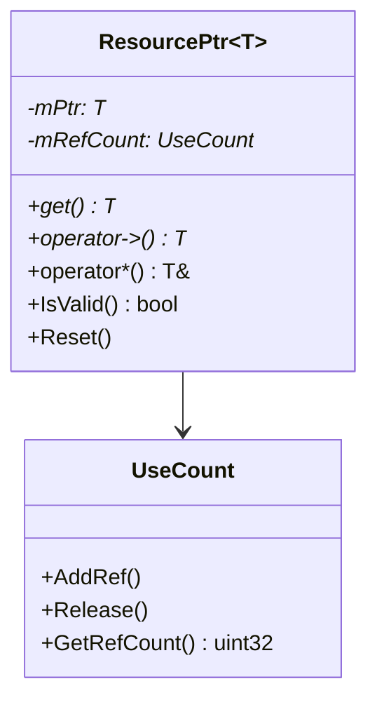
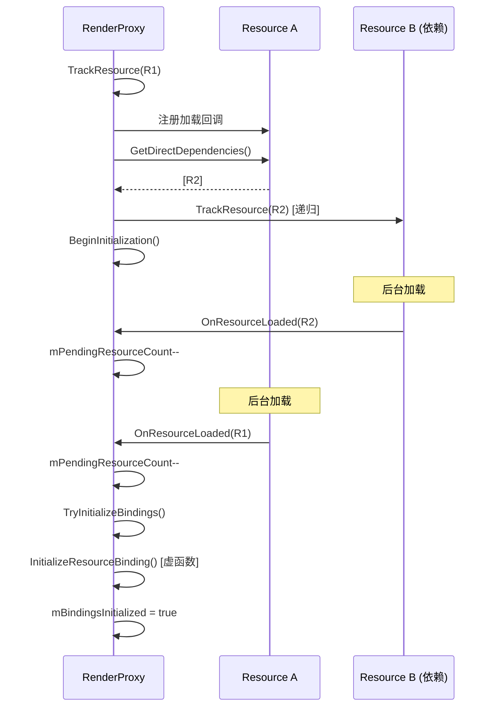

# 资源管理系统架构文档

---

## 1. 概述

Elaine Engine 的资源管理系统位于 **ElaineCore** 的 `Resource` 子模块，提供统一的资源加载、卸载、引用计数和异步加载机制。系统基于 **TaskGraph** 实现异步加载，通过 **ResourcePtr** 智能指针管理资源生命周期。

---

## 2. 核心类层次



---

## 3. 资源管理器



### 3.1 资源类型枚举

```cpp
enum ResourceType : uint8_t {
    RT_Texture,
    RT_Material,
    RT_MaterialInstance,
    RT_Shader,
    RT_Mesh,
    RT_GameObject,
    RT_Count
};
```

### 3.2 ResourceModule

`ResourceModule` 是资源系统的入口，管理所有 `ResourceManager` 实例。

---

## 4. 资源加载流程

### 4.1 同步加载



### 4.2 异步加载



---

## 5. 资源状态机



| 状态 | 描述 |
|------|------|
| `Unloaded` | 未加载 |
| `Pending` | 等待加载（已入队） |
| `Loading` | 正在加载中 |
| `Loaded` | 加载完成 |
| `Unloading` | 正在卸载 |
| `Failed` | 加载失败 |
| `Missing` | 资源文件缺失 |

---

## 6. 引用计数智能指针 (ResourcePtr)



**特性：**
- 侵入式引用计数
- 支持 `static_pointer_cast` 类型转换
- 线程安全的引用计数操作

---

## 7. 资源依赖

### 7.1 依赖声明

```cpp
// ResourceBase 提供依赖查询接口
virtual void GetDirectDependencies(
    std::vector<ResourceBasePtr>& OutDependencies
) const {}
```

### 7.2 RenderProxy 资源追踪

RenderProxy 提供了更高级的资源追踪机制：



---

## 8. 加载完成回调

```cpp
// 注册加载完成回调
resource->RegisterLoadCompleteCallback([](ResourceBase* res) {
    // 资源加载完成后执行
    LOG_INFO("Resource loaded: {}", res->GetPath());
});
```

**回调特性：**
- 线程安全（内部使用 `mCallbackMutex`）
- 支持多个回调注册
- 资源已加载时立即触发

---

## 9. 文件系统

### 9.1 核心类

| 类 | 职责 |
|----|------|
| `FileManager` | 文件管理器，路径解析 |
| `FileSystem` | 文件系统抽象 |
| `DataStream` | 数据流读写 |
| `DataStreamMgr` | 数据流管理器 |

### 9.2 资源目录结构

```
Contents/
├── config/              # 引擎与项目配置 (JSON)
├── material/            # 材质定义文件
├── material_instance/   # 材质实例文件
├── model/               # 3D 模型 (通过 assimp 导入)
├── render/              # 渲染管线配置
├── shader/              # 着色器源码 (GLSL/HLSL → SPIR-V)
├── texture/             # 纹理图片
└── worlds/              # 世界/关卡存档 (JSON)
```

---

## 10. 内存管理

### 10.1 MemoryMap

`ElaineMemoryMap` 提供内存映射文件支持，用于大文件的高效读取。

### 10.2 GPU 内存

- 支持专用分配 (Dedicated Allocation)、子分配 (Sub-Allocation) 等策略
