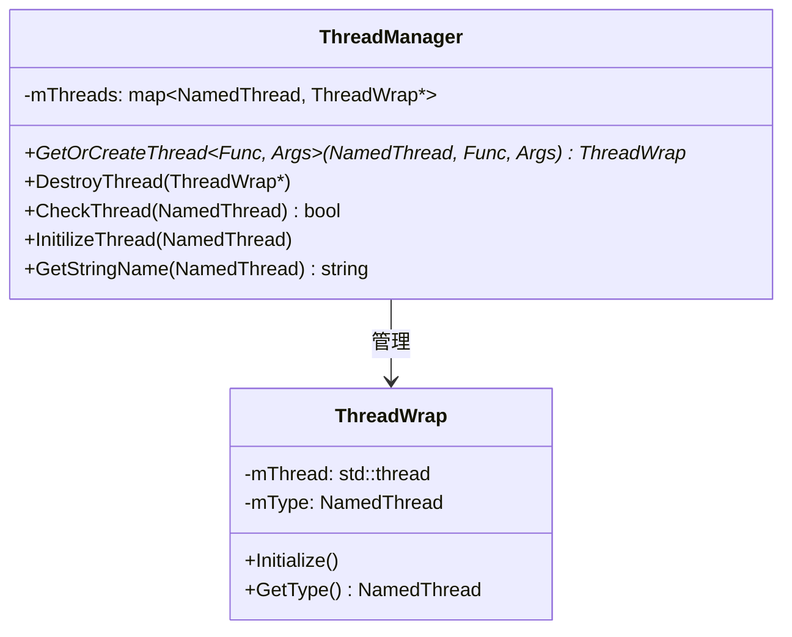
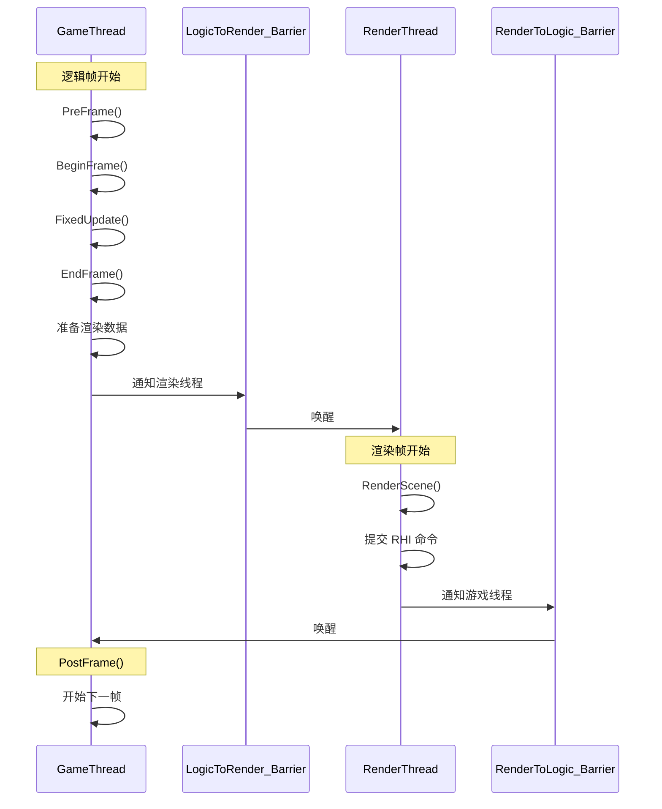
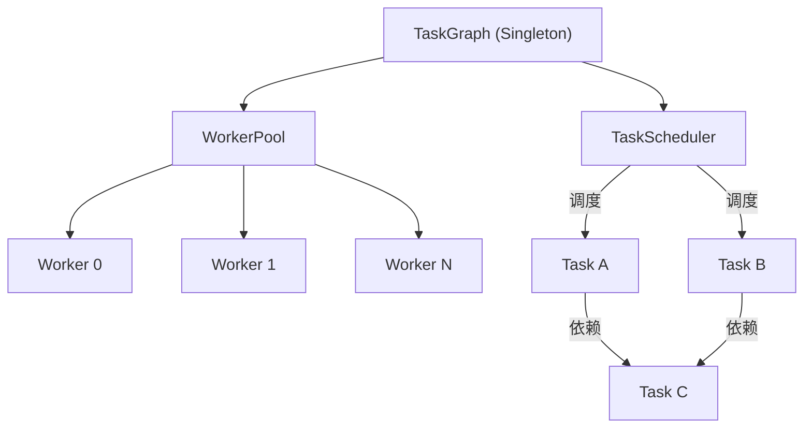
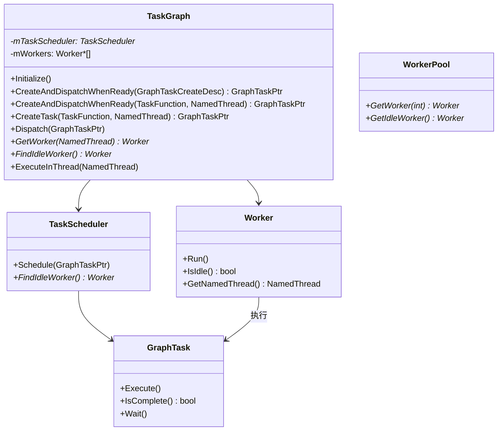
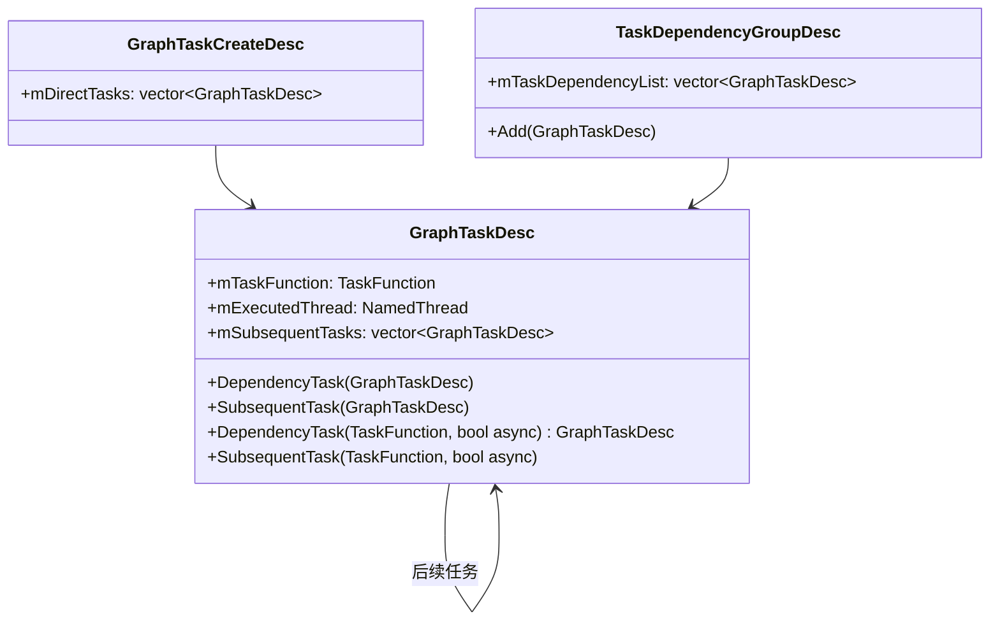
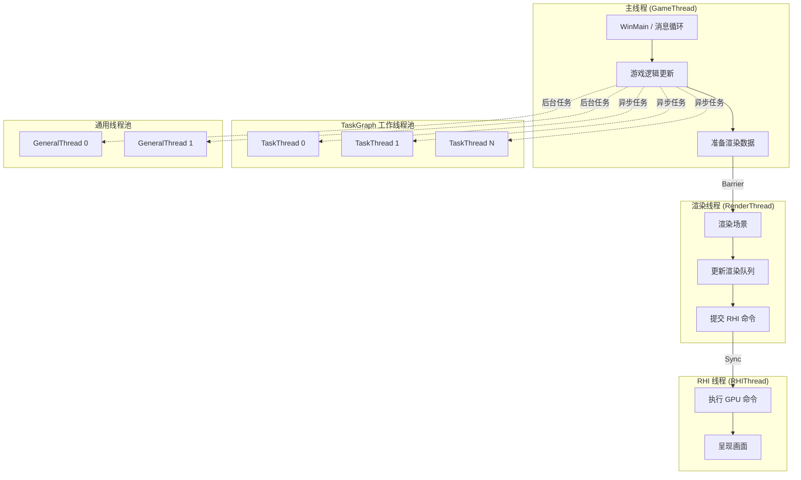

# 多线程与 TaskGraph 架构文档

---

## 1. 概述

Elaine Engine 的多线程系统由 **命名线程模型 (Named Thread Model)** 和 **TaskGraph 任务图** 两大机制组成。命名线程提供固定用途的专用线程，TaskGraph 提供基于 DAG 的灵活任务调度能力。

---

## 2. 命名线程模型

### 2.1 线程枚举

```cpp
enum class NamedThread : uint8_t {
    AnyThread,       // 任意线程（TaskGraph 自动分配）
    GameThread,      // 游戏逻辑主线程
    RenderThread,    // 渲染逻辑线程
    RHIThread,       // 渲染 API 命令线程
    TaskThread0,     // TaskGraph 工作线程 0
    TaskThread1,     // TaskGraph 工作线程 1
    TaskThread2,     // TaskGraph 工作线程 2
    TaskThread3,     // TaskGraph 工作线程 3
    TaskThread4,     // TaskGraph 工作线程 4
    TaskThread5,     // TaskGraph 工作线程 5
    TaskThread6,     // TaskGraph 工作线程 6
    TaskThread7,     // TaskGraph 工作线程 7
    GeneralThread0,  // 通用工作线程 0
    GeneralThread1,  // 通用工作线程 1
    GeneralThread2,  // 通用工作线程 2
    ThreadCount,     // 线程总数
    ScheduleThread,  // TaskGraph 调度器线程
};
```

### 2.2 ThreadManager



**特性：**
- Singleton 模式
- 线程按需创建，首次 `GetOrCreateThread` 时创建
- 自动初始化线程本地状态
- `CheckThread()` — 验证当前线程是否为指定命名线程

### 2.3 线程验证宏

```cpp
#define CheckInThread(InThreadName) Root::instance()->CheckThread(InThreadName);
```

用于运行时断言，确保关键代码在正确的线程上执行。

---

## 3. 线程同步

### 3.1 Barrier 同步

引擎使用双 Barrier 机制同步游戏线程和渲染线程：



### 3.2 RHI 线程同步

```cpp
void WaitForRHIThread_Gfx();    // 渲染线程等待 RHI 线程
void NotifyForRHIThread_Gfx();  // 通知 RHI 线程
void WaitForRenderThread_Gfx(); // RHI 线程等待渲染线程
void NotifyForRenderThread_Gfx(); // 通知渲染线程
```

---

## 4. TaskGraph 任务图

### 4.1 架构概览



### 4.2 核心类



### 4.3 任务描述



### 4.4 任务创建示例

**简单任务：**
```cpp
auto task = TaskGraph::instance()->CreateAndDispatchWhenReady(
    []() {
        // 在任意工作线程执行
        DoSomething();
    },
    NamedThread::AnyThread
);
```

**指定线程执行：**
```cpp
auto task = TaskGraph::instance()->CreateAndDispatchWhenReady(
    []() {
        // 在渲染线程执行
        RenderSomething();
    },
    NamedThread::RenderThread
);
```

**任务链（依赖关系）：**
```cpp
GraphTaskCreateDesc desc;
GraphTaskDesc taskA;
taskA.mTaskFunction = []() { LoadMesh(); };

GraphTaskDesc taskB;
taskB.mTaskFunction = []() { LoadTexture(); };

GraphTaskDesc taskC;
taskC.mTaskFunction = []() { CreateRenderProxy(); };

// A 和 B 完成后才执行 C
taskA.SubsequentTask(taskC);
taskB.SubsequentTask(taskC);

desc.mDirectTasks = { taskA, taskB };
TaskGraph::instance()->CreateAndDispatchWhenReady(desc);
```

### 4.5 Worker 分配

| Worker 类型 | 对应线程 | 职责 |
|-------------|----------|------|
| Worker[GameThread] | 游戏线程 | 执行绑定到游戏线程的任务 |
| Worker[RenderThread] | 渲染线程 | 执行绑定到渲染线程的任务 |
| Worker[RHIThread] | RHI 线程 | 执行绑定到 RHI 线程的任务 |
| Worker[TaskThread0-7] | 工作线程 | 执行 AnyThread 任务 |
| Worker[GeneralThread0-2] | 通用线程 | 通用后台任务 |

### 4.6 GraphEvent

`GraphEvent` 提供任务间的事件通知机制。

---

## 5. 并发工具

### 5.1 原子操作

引擎广泛使用 `std::atomic` 进行无锁并发：

```cpp
std::atomic<LoadState> mLoadState;         // 资源状态
std::atomic<int32_t> mPendingResourceCount; // 待加载资源计数
std::atomic<bool> mBindingsInitialized;     // 初始化标志
std::atomic_int mFPS;                       // FPS 计数
std::atomic<bool> mbInitialize;             // 初始化标志
```

### 5.2 互斥锁

关键数据结构使用 `std::mutex` 保护：

```cpp
std::mutex mMtx;            // ResourceManager 资源映射
std::mutex mCallbackMutex;  // ResourceBase 回调列表
std::mutex mTrackMutex;     // RenderProxy 资源追踪
```

### 5.3 双缓冲帧数据

SceneManager 使用双缓冲避免游戏/渲染线程竞争：

```cpp
std::array<RenderFrameData, 2> mFrameData;
std::atomic<uint32_t> mCurrentWriteFrame{ 0 };
std::atomic<bool> mFrameReady{ false };
```

---

## 6. 线程架构全景



---

## 7. 已知 TODO 与改进方向

根据源码注释，TaskGraph 系统有以下待改进项：

1. **事件通知机制** — 更完善的任务完成事件通知
2. **便捷创建接口** — 简化任务创建 API
3. **锁优化** — 减少线程锁争用
4. **任务链完成通知** — 通知客户端当前任务链是否已完全执行
5. **更便捷的创建接口** — 进一步简化 API
